# The designer

The designer is where a CAD assembly becomes step-by-step instructions. You import a STEP file, decide what each step shows, moves and highlights, add arrows, labels and a camera, write the text, and press Generate. It also writes a [project file](reference/project-toml.md) as you work, which you save with the models so you can come back to the assembly later.

It runs the real renderer in your browser rather than an imitation of it, so the preview is the file you download, and that file is identical to what the `3dstep` command produces from the same project.

## Running it

Use the hosted designer at **<https://3dstep.isiks.tech>**. Nothing is uploaded: the STEP reader and the renderer both run in your browser, and your files stay on your machine.

To run it yourself, install the tool and run it with no arguments:

```bash
pip install "git+https://github.com/xbst/3DStep.git@master"
3dstep
```

That picks a free port, opens a browser, and prints the address. Add `--port 8000` to choose the port, or `--no-browser` to leave the browser alone.

The designer must be served over HTTP. It fetches its runtime at startup, so opening `index.html` from disk does not work. To serve it with your own web server, see [serving the designer by hand](command-line.md#serving-the-designer-by-hand).

## The interface

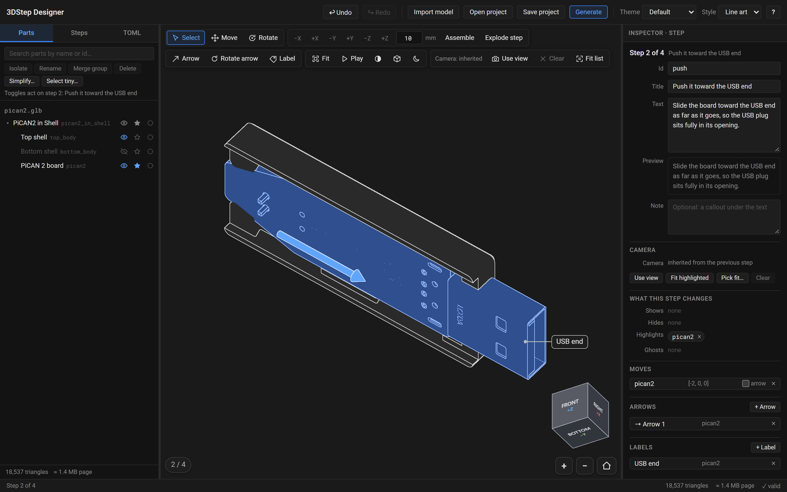

A toolbar across the top, three panels whose dividers you can drag, and a status bar at the bottom:

- **Toolbar**: Undo, Redo, **Import model**, **Open project**, **Save project**, **Generate**, the **Theme** and **Style** selectors, the renderer's status, and **?** for the About box.
- **Parts / Steps / TOML** (left): the model's parts, the list of steps, and the live, editable project file. The designer remembers which tab you last used.
- **Viewport** (middle): the model as the page will show it, in the current step, with the tools above it, the view cube in a corner, and the step counter and the zoom and reset-view buttons along the bottom.
- **Inspector** (right): the current step, or whatever is selected: parts, an arrow or a label.
- **Status bar**: the step, the selection, the triangle count, the size of the page, and the result of the same checks the `3dstep` command makes. A count of errors or warnings opens the list; **✓ valid** means the command would render the project cleanly.

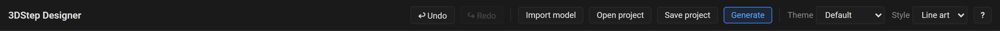

While the renderer is still starting, the toolbar shows its progress ("Starting renderer…", then "Loading 3DStep…") and **Generate** is disabled. Everything else works straight away, including importing.

The **Theme** selector sets the project's `theme`, and **Style** its `style`: line art, white parts with dark edges as in a printed manual, or shaded, in the model's colors. The viewport previews both. The designer's own chrome keeps its dark colors whichever theme you pick, and the viewport previews the page's dark palette until you switch it with the scheme button in the viewport's toolbar. See [Themes](reference/themes.md).

Below 900 pixels wide the inspector moves under the viewport, and below 700 pixels everything stacks. The designer is a desktop tool: it works on a laptop screen, and a phone is better for checking the generated page than for building one.

## Workflow

### 1. Import a model

Click **Import model** and choose one or more `.step`, `.stp`, `.glb` or `.gltf` files, or drop them on the viewport. Each file becomes one **model** of the project, saved as one GLB file named after it: `PiCAN2-in-Shell.step` becomes `pican2_in_shell.glb`. A second import adds a second model beside the first.

For a STEP file, the **Import a STEP model** dialog asks how to read it:

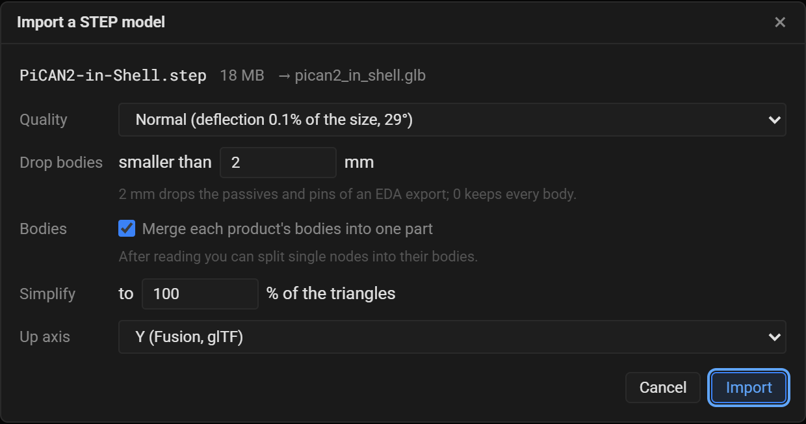

- **Quality**: how finely curved surfaces become triangles. **Fine**, **Normal** or **Coarse**; each names its deflection, the largest distance between the surface and its triangles as a share of the model's size, and the largest angle between neighboring triangles.
- **Drop bodies smaller than**: bodies whose bounding box is smaller than this many millimeters across are left out. 2 mm drops the passives and pins of a board exported from an EDA tool; 0 keeps every body. Parts keep the same ids whatever the filter, so you can import again with another value and the steps still find their parts.
- **Merge each product's bodies into one part**: one part per component of the assembly, which is what you usually move and highlight. Off, every body is a part of its own.
- **Simplify**: reduce the triangles to this share as the model is added.
- **Up axis**: the axis that points up in your CAD tool. The first STEP model of a project proposes **Y**, which is Fusion's; most other CAD tools use **Z**. The first model's choice becomes the project's `up`.

Click **Import**. The reader runs OpenCascade in your browser, off the page's thread, with a progress line and a timer. A small assembly takes seconds and a 40 MB board about a minute. **Cancel** stops it at once.

Then the dialog shows what the import gives:

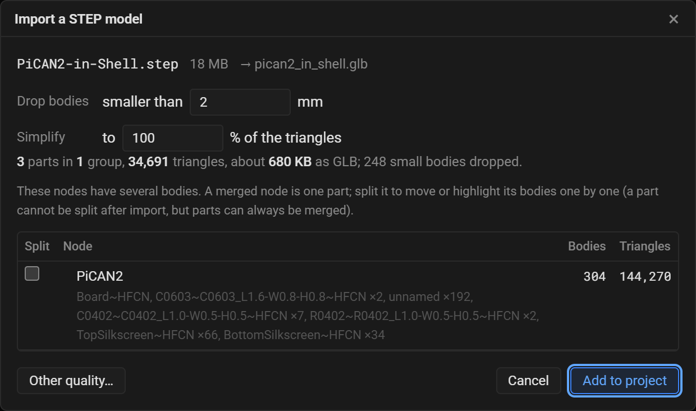

The summary counts the parts, groups and triangles, estimates the model's size, and says how many small bodies the filter dropped. The size filter can still change here, and the summary follows at once; only another quality needs another read, with **Other quality…**. Simplification runs when you add the model, so the counts are the ones before it.

The table lists every component with several bodies. A merged component is one part; check **Split** to make each of its bodies a part, to move or highlight them one by one: a bag of screws exported as one component, say. Decide here: a part cannot be split after the import, but parts can always be merged later.

**Add to project** adds the model. The first model also names an untitled project after its file, sets the project's up axis, and adds a first step.

A GLB written by 3DStep is used as it is. A GLB from another tool asks for its **Unit** (millimeters, meters or inches; glTF's own unit is meters) and **Up axis** (Y, glTF's convention, or Z), and is converted to millimeters and the project's axes.

!!! note "Large STEP files"
    The browser's STEP reader has a memory limit of 2 GB, which a STEP file of about 45 MB or more fills while reading. The import then stops with an out-of-memory message, and the designer keeps working. Export the assembly as several STEP files, one model each, in their assembled positions and each with its own top-level assembly name, and import them one after another. Or convert the file with [`3dstep model.step`](command-line.md#convert-a-step-file), which has no such limit, and import the GLB it writes.

### 2. Trim the model in the Parts tab

The **Parts** tab lists every loaded model and its tree of groups and parts. Each row shows the part's name, its id in gray, and three toggles that act on the **current step**: visible (the eye), highlighted (the star) and ghosted (the dashed circle), which shows the part translucent, for context.

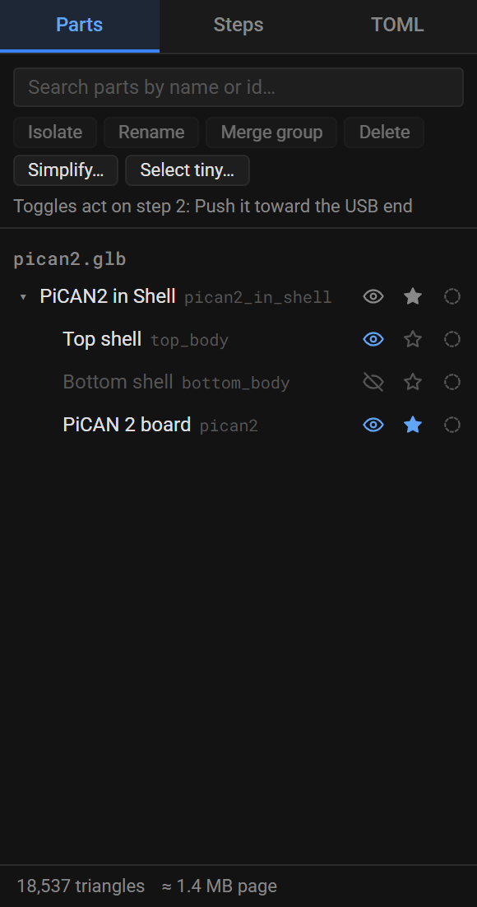

- **Search** filters the tree by name or id.
- **Click** a row to select the part, **Ctrl+click** to add or remove one, **Shift+click** to select a range. The selection is shared with the viewport and the inspector.
- **Isolate** shows only the selection in the current step.
- **Rename** (or `F2`, or a double click) changes the part's display name, which the page shows. Its **id** never changes after the import, so the steps' references stay valid.
- **Merge group** turns the selected group into one part with the group's id.
- **Delete** removes the selection from its model, after a confirmation. The steps stop naming it, and Undo brings it back.
- **Simplify…** reduces the triangles of the selected parts, or of all of them.
- **Select tiny…** selects every part whose bounding box is smaller than a size, to delete them together.

The line at the bottom shows the triangle count and the estimated size of the generated page. It turns amber above about 3 MB, the size a page should stay under so it loads quickly on a phone. Deleting what the instructions never show, merging groups and simplifying are the ways down; see [Keeping pages small](concepts.md#keeping-pages-small).

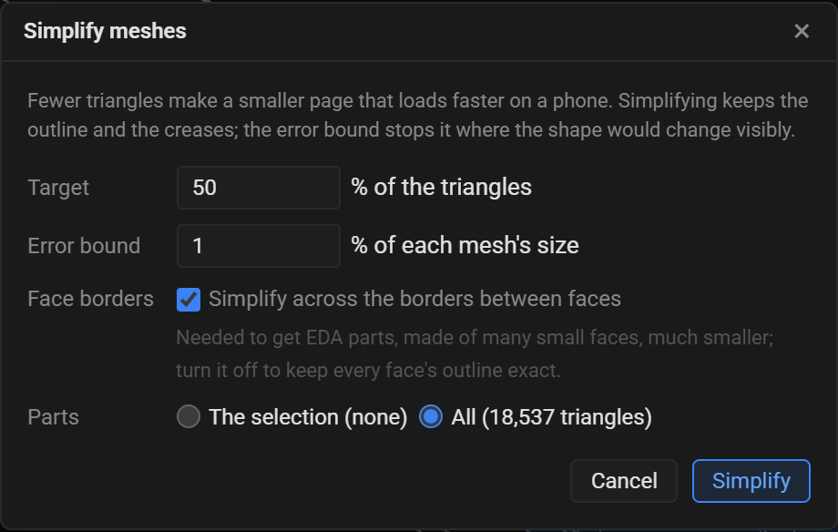

**Simplify** reduces each part's triangles toward the **Target** share, as long as the shape stays within the **Error bound**, a share of each part's size. **Simplify across the borders between faces** lets it merge triangles across the edges of the CAD faces, which an EDA board needs to get much smaller, since it is made of many small faces; turn it off to keep every face's outline exact.

A model that is not saved as it stands, a new import or one you deleted parts from, merged or simplified, is marked **unsaved** in the tree until you save.

### 3. Lay out the steps in the Steps tab

The **Steps** tab holds the assembly's settings and the list of steps.

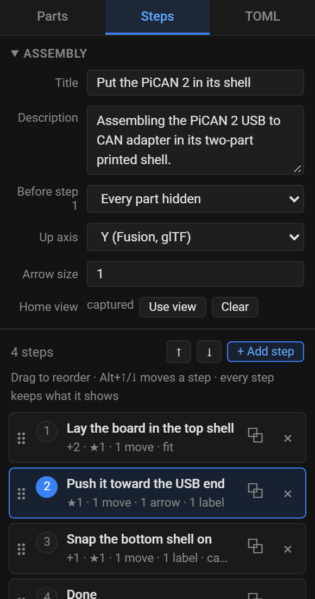

The **Assembly** box sets the page's **Title** and **Description**, what every part is **Before step 1** (visible, or hidden when each step adds parts), the **Up axis**, and the **Home view**: **Use view** makes the current view the page's home view, where step 1 starts, and **Clear** fits the model instead.

Below it, the list of steps. Each row shows the step's title and a summary of what it changes: `+2` shows two parts, `−1` hides one, `★1` highlights one and `◌1` ghosts one, then its moves, arrows and labels, and `camera` or `fit` when it has a view of its own.

- **Click** a step to make it current. The viewport, the inspector and the Parts tab's toggles follow.
- **+ Add step** adds a step after the current one, with the same parts visible and nothing moved or highlighted.
- **Duplicate** copies a step with everything in it.
- **Drag** a step, or use the **↑** and **↓** buttons or `Alt+↑` / `Alt+↓`, to reorder.
- **×** deletes a step.

Every step keeps what it shows: reordering or deleting steps, and showing or hiding parts in one, rewrites the project so that every other step still displays the same parts. Showing a part makes it visible in the current step only; **Shift+click** its eye to show it from the current step on.

### 4. Work in the viewport

The viewport shows the current step as the page will, with the tools in a toolbar above it.

- **Look around**: drag to rotate, right-drag to pan, scroll to zoom, double-click to center the view on a point. The view cube in the corner flies the view around: click a face to look from that side, an edge to look from between two sides, a corner to look from three at once. Its faces are named as in Fusion: with Z up, the front is −Y; with Y up, +Z.
- **Select**: click a part to select it, **Shift+click** or **Ctrl+click** to add or remove one, **Alt+click** to select its group, click empty space to clear. Clicking an arrow or a label selects it.

The tools, in groups:

| Tool | Key | What it does |
|---|---|---|
| **Select** | | Selects parts, arrows and labels. |
| **Move** | `G` | Drag the gizmo's arrows or planes to move the selection. It moves in 1 mm steps; hold `Alt` to move freely. |
| **Rotate** | `R` | Drag the gizmo's rings to turn the selection about its center, in 15° steps; hold `Alt` to turn freely. |
| **−X +X −Y +Y −Z +Z** | | Move the selection along an axis by the distance in the field beside them, in millimeters. Presses add up. |
| **Assemble** | | Put the selection back in its assembled place, or with nothing selected every part of the step. |
| **Explode step** | | Stack the parts the step highlights along the up axis, above the rest and the distance apart, so none overlap. |
| **Arrow** | `A` | Click a point on a part for the tail, then a second point for the head. Hold `Shift` for the head to stay on the line straight out of the first surface. |
| **Rotate arrow** | `Shift+A` | Click a surface: an arrow turns around the line straight out of it, sized to the part. |
| **Label** | `L` | Click a point on a part, then type the label's text in the inspector. |
| **Fit** | `F` | Fit the view to the selection, or to everything shown. |
| **Play** | | Play the step's moves, as the page's Play button does. Again: back to the start. |
| Style, projection, scheme | | Switch the project between line art and shaded; the view between orthographic and perspective (**Use view** stores it in the step); and the preview between the page's light and dark palette. |
| **Use view** | | Use the current view as the step's camera. |
| **Clear** | | Clear the step's camera: it uses the previous step's again. |
| **Fit list** | | Make the step's camera frame the selection, or with nothing selected the parts the step highlights, from the previous step's direction. |

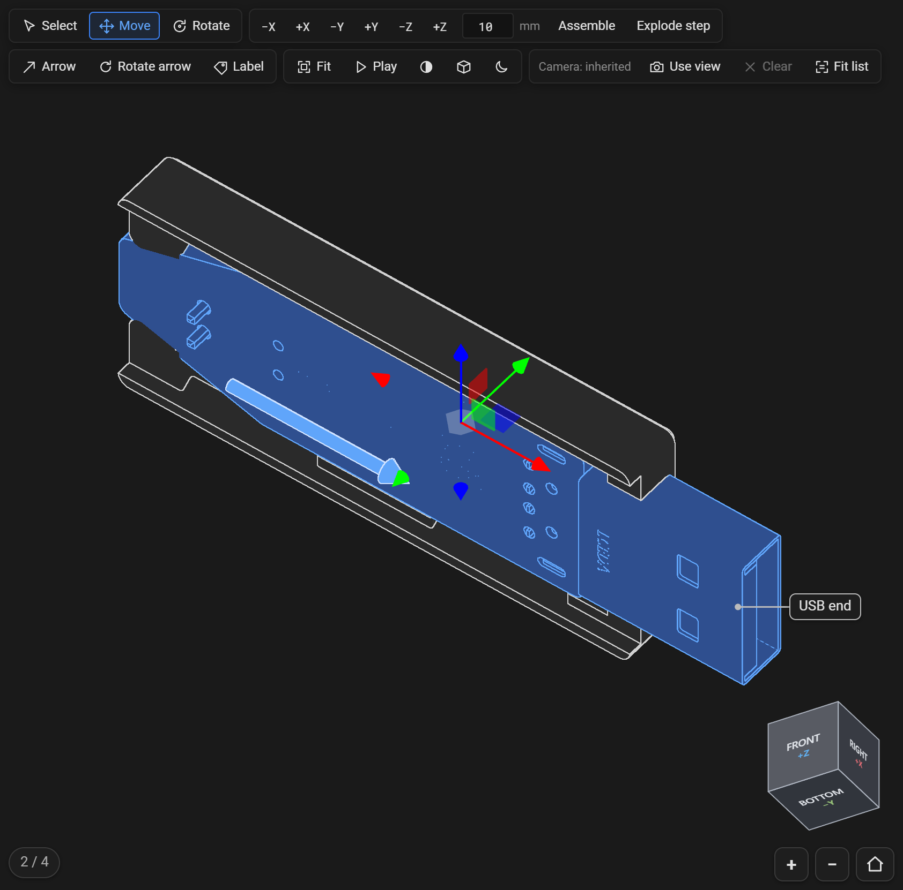

A **move** places parts for the current step only, relative to their assembled place. Move a part out with the gizmo or the axis buttons, and the page shows it there, with an arrow back to where it goes, and plays it into place when the reader presses Play or goes on to the next step. Moving several parts at once moves them as one rigid body. A drag is one undo step, and `Esc` during a drag puts the parts back.

Arrows and labels placed with the tools are **attached** to the part you click: their points are stored in that part's frame, so they travel with it while it moves. While you place an arrow, a preview follows the pointer and a line at the bottom of the viewport says what the next click does:

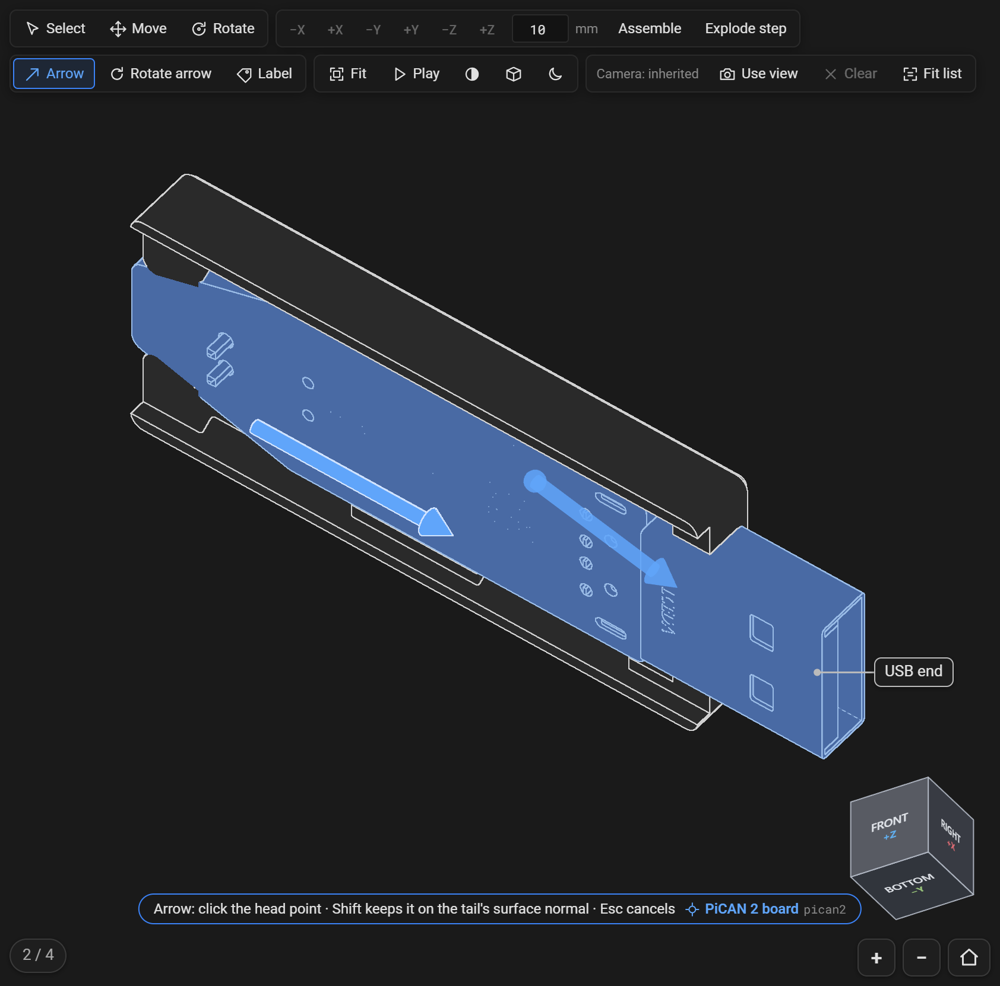

`Esc` cancels a tool's pending click, then goes back to **Select**; with **Select** active it clears the selection.

### 5. Edit in the inspector

The inspector edits whatever is selected. With nothing selected, it edits the current step:

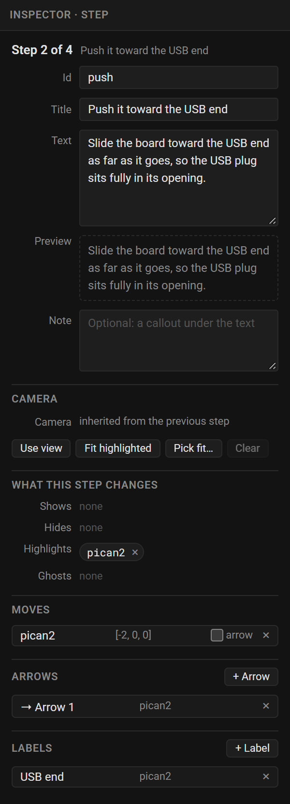

- **Id** names the step in links (`?step=push`). Leave it empty for `step-2` and so on.
- **Title**, **Text** and **Note**: the instruction. A blank line in the text starts a paragraph, and `**bold**`, `` `code` `` and `[links](https://example.com)` work; the **Preview** shows the result. The note appears as a callout under the text.
- **Camera** says where the step's view comes from, the previous step's, its own, or a fit to parts, with **Use view**, **Fit highlighted** (frame what the step highlights), **Pick fit…** (click the parts to frame in the viewport, `Esc` to finish) and **Clear**.
- **What this step changes** lists the ids it shows, hides, highlights and ghosts. Click one to select it, or **×** to take it out of the list.
- **Moves**, **Arrows** and **Labels** list the step's own. Click one to select it. A move's **arrow** checkbox draws the arrow from the part to its assembled place, and its **×** puts the parts back. **+ Arrow** and **+ Label** add one to edit by hand.

With parts selected, it shows their **Id** (fixed), their name in the CAD file, a display **Name**, and a **Color** that overrides the model's in the shaded style; then the current step's **Visible**, **Highlight** and **Ghost** checkboxes, the move's **Offset** in millimeters and **Rotate** in degrees about each axis, the **Auto arrow** checkbox, and buttons for the Move and Rotate tools, **Fit view**, **Isolate** and **Remove from step**.

With an arrow selected, it edits its **Kind** (straight, or rotate around an axis), its two points (**From** and **To**, or **Center** and **Axis to**), the rotate arrow's **Turns** and **Radius**, a **Color**, a **Label** at its tail and the part it is **Attached** to. A label has its **Text**, **Anchor**, **Side** and attachment. **Pick** beside a point takes it from a click in the viewport. Unchecking **Attached** converts the points to model coordinates, and checking it again converts them back, so nothing moves on screen. **Step** returns to the step.

A rotate arrow placed with the tool turns clockwise as you look at the surface you clicked, the way a screw goes in: its **Axis to** point is inside the part. To show one coming out, make its **Turns** negative; [`turns`](reference/project-toml.md#steparrow) explains the rule.

### 6. Edit the TOML directly (optional)

The **TOML** tab holds the project file, live. The two directions stay in step: type there and the viewport updates, change something with the panels and the text updates. It is useful for bulk edits, or for pasting in camera numbers.

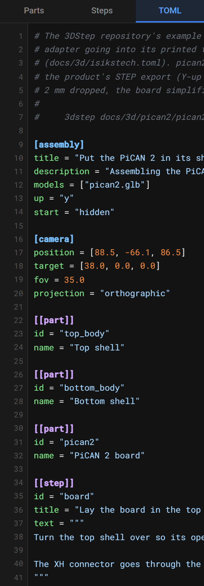

Edits made with the panels rewrite only the values that change, so your comments and layout stay as written. Text that does not parse keeps its place with the error, and blocks edits from the panels until you fix it. Naming a model file the designer has not loaded shows a banner with a button to open it.

### 7. Generate the page

Click **Generate**. The dialog renders the page with the same code as the `3dstep` command and shows the real page, sized by its own height report the way a docs site embeds it.

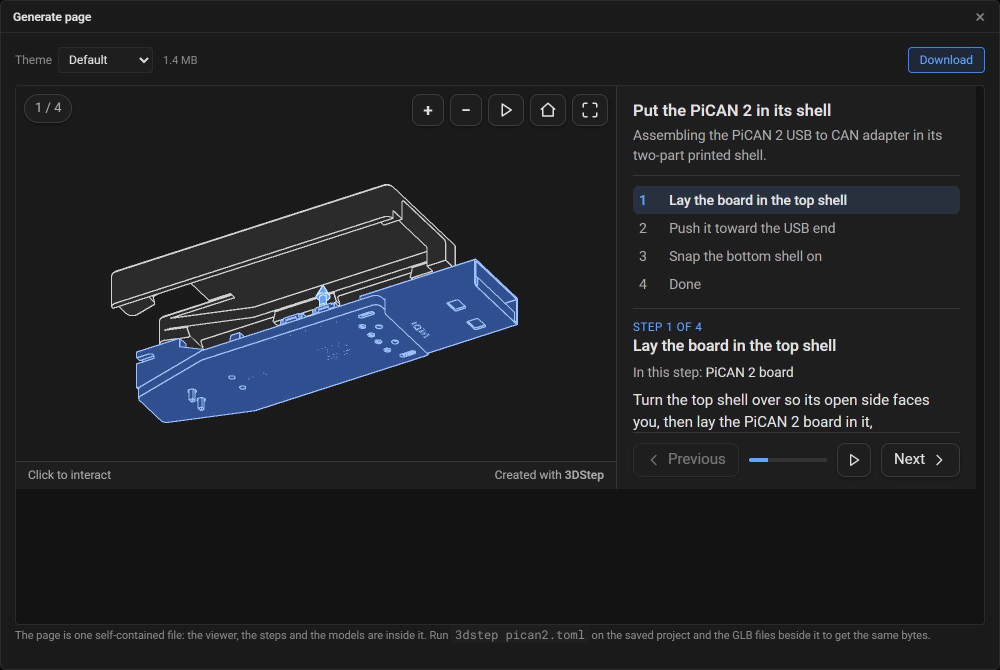

- **Theme** sets the project's `theme`, the same setting as the toolbar's selector, and renders again, so the page you download matches the project you save.
- The size beside it is the size of the page you are about to download.
- **Download** saves the page as `<project name>.3dstep.html`.

Problems the page renders with anyway are listed above the preview. If the project cannot be rendered, the dialog shows why and Download is disabled until it can.

### 8. Save and open projects

Click **Save project** (`Ctrl+S`). It saves the project file, `<name>.toml`, then every model marked unsaved, as `<model>.glb`. Where the browser lets a page choose where files go, you pick the folder for the TOML and each model is suggested beside it; elsewhere they download. Keep them in one folder: the project finds its models by file name, and a banner reminds you which files belong together.

**Open project** takes the TOML and its GLB files together, chosen at once or dropped on the viewport together. A project whose models are not all loaded shows a banner naming them, with a button to open each of the first three.

If you close or reload the tab with changes you have not saved, the browser asks you to confirm first.

## Keyboard shortcuts

| Shortcut | Action |
| --- | --- |
| `Ctrl+Z` | Undo |
| `Ctrl+Y` or `Ctrl+Shift+Z` | Redo |
| `Ctrl+S` | Save project |
| `Ctrl+D` | Duplicate the current step |
| `←` / `→` | Previous / next step |
| `G`, `R` | Move tool, Rotate tool |
| `A`, `Shift+A`, `L` | Arrow tool, Rotate arrow tool, Label tool |
| `F` | Fit the view to the selection, or to everything shown |
| `Delete` or `Backspace` | Take the selected parts out of the current step (its lists and moves), or delete the selected arrow or label |
| `Esc` | Cancel the tool's pending click, then back to Select; with Select, clear the selection. In an inspector field, leave the field |
| `Alt` while dragging the gizmo | Move or turn freely instead of in 1 mm and 15° steps |
| `↑` / `↓`, `Home` / `End` | In the Parts tree or the step list: select the previous / next, first / last row |
| `Alt+↑` / `Alt+↓` | In the step list: move the step up / down |
| `Delete` | In the step list: delete the step |
| `→` / `←` | In the Parts tree: open / close a group |
| `Space` | In the Parts tree: show or hide the part in the current step |
| `F2` | In the Parts tree: rename the part |

Use `Cmd` in place of `Ctrl` and `Option` in place of `Alt` on macOS. The tool keys and the step keys are ignored while you are typing in a field, and all of these are ignored while a dialog is open.

## Troubleshooting

### "Renderer unavailable" in the toolbar

The designer downloads its Python runtime from `cdn.jsdelivr.net` on first load. If that host is blocked by a network policy, an extension or an offline machine, the designer cannot render: **Generate** stays disabled, and the status bar cannot check the project. Importing, editing and saving still work.

Allow `cdn.jsdelivr.net`, or render the saved project with the [command line tool](command-line.md), which needs no network at all. Hover the message for the underlying error.

If you serve the designer folder yourself, the same message means its payload, `threedstep.zip`, is missing from beside `index.html`. See [serving the designer by hand](command-line.md#serving-the-designer-by-hand).

### The import runs out of memory

A STEP file of about 45 MB or more fills the browser reader's 2 GB of memory. Split the assembly into several STEP files in your CAD tool, or convert it on a machine with [`3dstep model.step`](command-line.md#convert-a-step-file); see [Import a model](#1-import-a-model).

### My theme is missing

The designer offers the themes bundled with 3DStep. It cannot read a theme in a project's own `theme_dir`, because that folder is on your disk and the designer only has the project file. Such a project previews with the default look, and the status bar reports the theme: as an error when the theme is meant to be in `./themes`, the default `theme_dir`, and as a warning with another folder. **Generate** says it cannot use the theme. Picking a bundled theme in the Generate dialog renders the page with it, but that sets the project's `theme` too, as the toolbar's selector does: undo it before you save, or the project loses its own theme's name. Render the project with the [command line tool](command-line.md) to get the page in its own theme. A docs site's own theme, like the one on this site, works this way.

### The status bar says two models share an id

Ids are made from the names in the CAD file, one model at a time, so two models whose parts have the same names get the same ids, and the page cannot tell those parts apart. This happens most with an assembly split into several STEP files whose top-level assemblies have the same name. Give each file its own top-level assembly name in your CAD tool before exporting.

### A model added later lies on its side

The project's up axis comes from its first model. A model added later, written with another up axis, is used as it is: a Z-up GLB in a Y-up project lies on its side. Import every model of a project with the same up axis.
