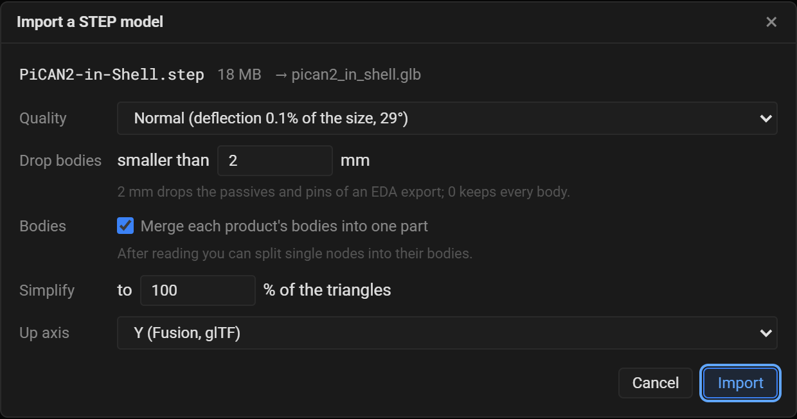
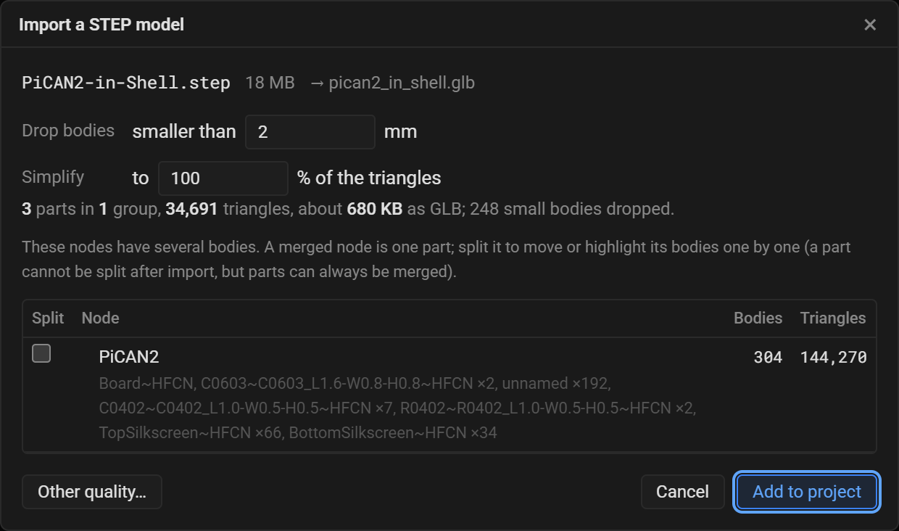
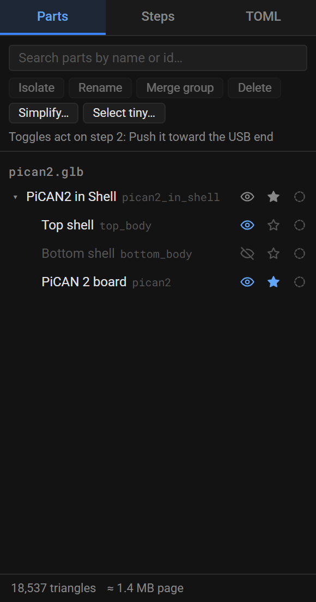
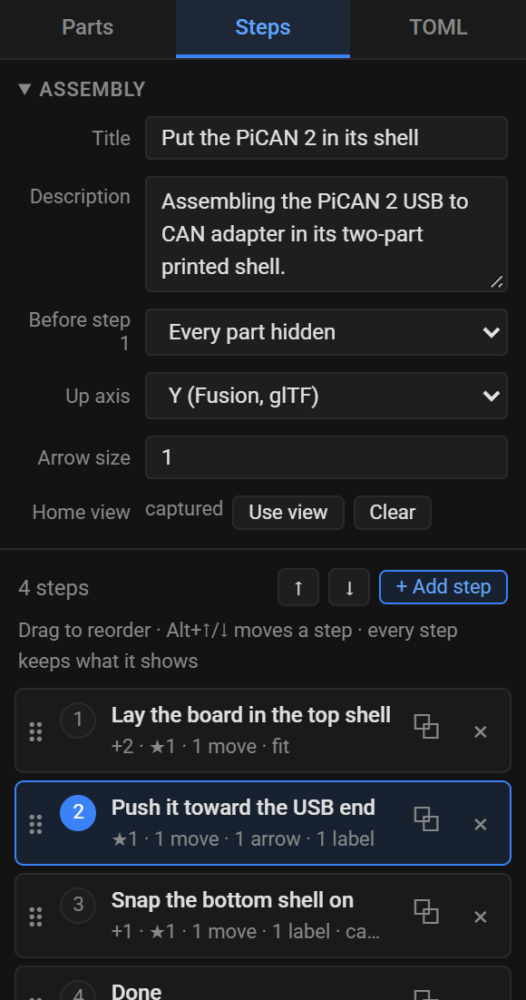
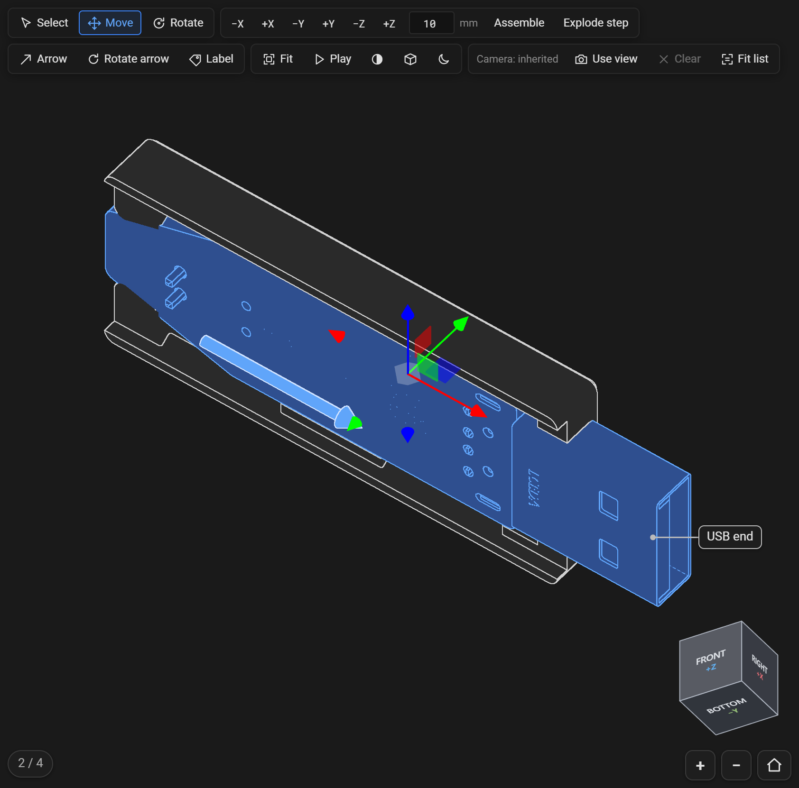
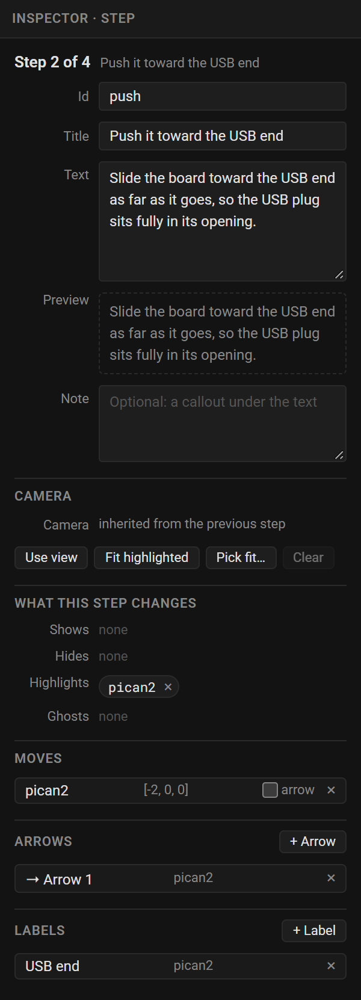
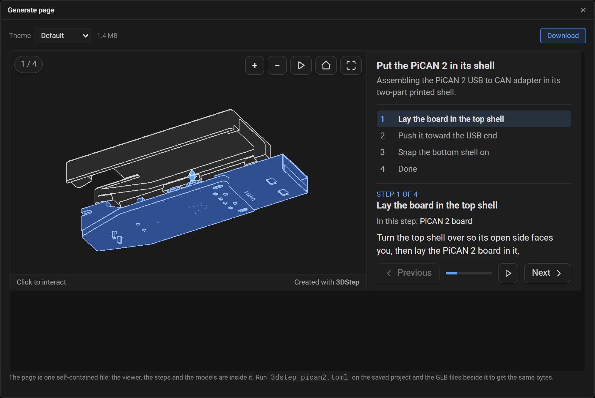

# Getting Started

This guide takes you from a STEP file of your assembly to a finished page of interactive assembly instructions. It happens entirely in your browser.

## What you need

- A **STEP file** (`.step` or `.stp`) of the assembly, exported from your CAD tool. Every part the instructions move, highlight or show on its own should be a top-level component of it: the STEP reader keeps the top level of the assembly's tree and brings a sub-assembly in as one part, so export a sub-assembly whose parts move separately as a STEP file of its own, in its assembled position, or make its parts top-level components. A GLB from another 3D tool works too.
- A browser. Nothing else: the designer reads the CAD file and renders the page itself, so there is no install step.

The first load fetches a Python runtime of roughly 10 MB, which takes a few seconds and is then cached; the toolbar tells you when it is ready. The STEP reader, OpenCascade compiled to WebAssembly, downloads the first time you import a STEP file.

## Step 1: Open the designer

Go to **<https://3dstep.isiks.tech>**. The designer runs in your browser, so your CAD files never leave it.

If you prefer to run it yourself, install the tool and run it with no arguments instead:

```bash
pip install "git+https://github.com/xbst/3DStep.git@master"
3dstep
```

That starts a local server and opens a browser. See [Command line and CI](command-line.md) for the details.

## Step 2: Import your STEP file

Click **Import model**, or drop the file on the viewport. The import dialog asks how to read it:



- **Quality** sets how finely curved surfaces are turned into triangles. **Normal** suits most assemblies.
- **Drop bodies smaller than** leaves out tiny bodies. The default of 2 mm drops the resistors, capacitors and pins of a board exported from an EDA tool, which a reader does not need and which make the page large. Use 0 to keep everything.
- **Merge each product's bodies into one part** makes each component of the assembly one part, which is what you move and highlight. You can split single components in the next screen.
- **Up axis** is the axis that points up in your CAD tool. The dialog proposes **Y**, Fusion's usual axis; most other CAD tools export **Z**-up, and so does a Fusion design made with its Z-up orientation. The first model is never turned, so the choice only records which way is up, and a wrong one is easy to fix: after the import, click **Top** on the view cube in the viewport's corner, which should look down on the model. If it looks at the model from the side, change **Up axis** in the Steps tab's Assembly box, before adding more models, which are turned to the project's axis. Everything keeps the CAD tool's coordinates, in millimeters.

Click **Import**. Reading takes a few seconds for a small assembly and up to a minute for a big one, all of it in your browser. Then the designer shows what it found:



Check **Split** on a component whose bodies you want to move one by one, such as a bag of screws exported as one component, then click **Add to project**. The model appears in the viewport and its parts in the **Parts** tab, and the designer adds a first step.

## Step 3: Keep the page small

The generated page carries the whole model inside it, so its size follows the model's. The **Parts** tab shows both at the bottom: the triangle count and the size of the page you would get.



Aim for a page under about **3 MB**, which loads quickly on a phone. To get there:

- **Delete** parts the instructions never show.
- **Select tiny…** selects every part under a size, to delete them together.
- **Merge group** turns a group of parts into one part; with several parts selected it reads **Merge parts** and merges them into the one you pick.
- **Simplify…** reduces the triangles of the selected parts, or of all of them, while keeping their outlines and creases.

The example on this page was 34,691 triangles after the import, and 18,537 after simplifying the board to half: a 1.4 MB page.

## Step 4: Build the steps

Each step is one instruction. It says which parts are visible, which are highlighted as the ones this step installs, where moved parts sit, and what the camera looks at. Open the **Steps** tab to see the list:



Set **Before step 1** to **Every part hidden** when each step adds parts, as most assembly instructions do. **+ Add step** adds a step after the current one, with the same parts visible and nothing moved or highlighted.

Then, for each step:

1. **Show the parts it adds.** In the **Parts** tab, click a part's eye. The toggles act on the current step only, and a step you add after it starts with the same parts visible. To show a part in the steps that already follow too, **Shift+click** its eye.
2. **Highlight what it installs.** Click the star beside those parts. Highlighted parts are tinted, and the page lists them under the step's title.
3. **Move them out.** Select a part in the viewport and press `G` for the Move tool, then drag the gizmo's arrows to where the part starts, above or beside where it goes. The page shows the part there with an arrow to its place, and plays it into place when the reader presses Play or goes to the next step.

    

4. **Point things out.** The **Arrow** tool (`A`) draws an arrow from one point to another, and the **Label** tool (`L`) puts a callout on a point. Both stay attached to the part you click, so they travel with it.
5. **Frame it.** Turn the view with the mouse until the step reads well, then click **Use view**. A step without its own view keeps the previous step's.
6. **Write the instruction.** With no part selected, the inspector on the right edits the step: its title, its text and an optional note.



[The designer](designer.md) covers every tool and field in detail.

## Step 5: Generate

Click **Generate**. The dialog renders your page and shows it exactly as it will look.



**Theme** changes the colors, fonts and layout of the finished page. Four are built in. Switch between them to see the effect, and read [Themes](reference/themes.md) to write your own.

Click **Download** to save the page. Open it in a browser and you have a page like this one, live here:

{ type=iframe }

## Step 6: Save the project too

Click **Save project**. It saves the project the designer has been writing as you work, a `.toml` file, and one `.glb` file per imported model. Keep them in one folder: the project finds its models by file name.

You don't need them for the page you just downloaded, but they make the next revision easy: **Open project** loads them back, you adjust, and you generate again. The [command line](command-line.md) renders the same page from them, byte for byte.

## Where to go next

- [The designer](designer.md): every panel and tool, plus what to do when something looks wrong.
- [Concepts](concepts.md): how steps, moves and cameras work, and how to keep a page small.
- [Command line and CI](command-line.md): render pages from the command line, or from CI.
- [Embedding with md-iframe](../md-iframe/embedding.md): put the page into an MkDocs or Zensical site.
