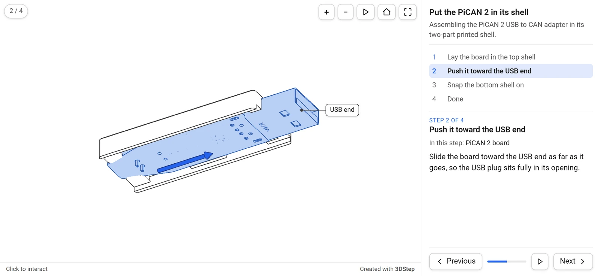

# The generated page

This page describes what `3dstep` and the designer's Generate produce: a single HTML file with the viewer, the steps and the models inside it. It covers what readers can do with it, how it behaves inside a documentation site, and the URL parameters and messages that control it from outside.

## What is in the file

Everything the page needs is inlined: its CSS, the viewer, the 3D library ([three.js](https://threejs.org)), the project's steps and every model. It works opened from disk or served from any static host, with nothing beside it. The viewer takes about 0.9 MB of every page and the models the rest; [Concepts](../concepts.md#keeping-pages-small) has the guidance on size.

Its one external reference is the theme's font, loaded from Google Fonts unless the theme uses a `bundled` or `system` font. Without a network the page still works, with a system font.

## The layout



- **The view** shows the model in the current step. The step counter is in its top left corner, and its buttons in the top right: zoom in, zoom out, **Play** (which turns into **Reset** once the step's moves have played), **Reset view**, and **Fullscreen**. A theme can add buttons that switch between line art and shaded, and between orthographic and perspective.
- **The bar** under the view says how to steer it, and links to 3DStep.
- **The step panel** holds the assembly's title and description, the list of steps, and the current step: its number, its title, the parts it installs, its text and its note. **Previous**, a progress bar, **Play all** and **Next** stay at its bottom whatever the length of the text.

When the page is 760 pixels wide or less in the default theme, on a phone or in a narrow frame, the panel moves under the view, and the page grows and shrinks with each step's text. A theme can keep the panel under the view at every width, float the step's text over the view instead, or leave it out; see [`[behavior]`](themes.md#behavior). An embed can also leave it out with [`?controls=`](#url-parameters).

## Reading the steps

- **Next** and **Previous**, a click on a step in the list, or a swipe left or right on the panel on a touch screen.
- The keyboard, once the viewer has focus (click it, or `Tab` to it): `→` or `Page Down` for the next step, `←` or `Page Up` for the previous one, `Home` and `End` for the first and the last.
- **Play** moves the step's moved parts into their places, and **Reset** puts them back. **Next** plays the moves the next step does not keep before it goes on, so reading through with Next shows every part going into place.
- **Play all** steps through on its own from the current step, and stops at the last one, or as soon as the reader changes the step, presses Play or turns the view.

Moving to a step glides the parts to their new places and flies the camera to the step's view. A zoom while the camera flies (the wheel, the **+** and **−** buttons or keys) is kept and applied where it arrives. A reader whose system asks for reduced motion gets no animation: steps switch at once.

## Turning the view

| | Mouse | Touch |
|---|---|---|
| Rotate | Drag | Drag with one finger |
| Pan | Right-drag | Drag with two fingers |
| Zoom | Scroll, or the **+** and **−** buttons and keys | Pinch |
| Center on a point | Double-click | Double-tap |

**Reset view** goes back to the step's view.

### Scrolling past an embedded page

A 3D view inside a documentation page must not trap the page's scrolling, so an embedded viewer does not take the mouse wheel or one-finger drags until the reader asks for it. Until then the page scrolls past it as usual, and the bar under the view reads "Click to interact" ("Tap to interact" on a touch screen). `Ctrl` or `Cmd` with the wheel, and a pinch, zoom it anyway.

A click or a tap on the view activates it: an outline in the theme's accent color shows it, and the bar says how to steer it ("Drag to rotate · Scroll to zoom · Esc to release"). It lets go on `Esc`, on a click outside it, when it scrolls out of sight, or two seconds after the mouse leaves it.

The step panel never holds the wheel either, active view or not: over it, the wheel scrolls a step text longer than the panel, then the page once the panel reaches its end, and a panel with nothing to scroll leaves the wheel to the page. Only in fullscreen does the panel keep its scrolling to itself, so the page behind it stays where it was.

A page opened on its own, or in fullscreen, takes the mouse from the start.

### Fullscreen

The **Fullscreen** button gives the page the whole screen, with the step's text and buttons over the view. An embedded page that cannot go fullscreen, on an iPhone or in an iframe that does not allow it ([md-iframe](../../md-iframe/embedding.md)'s do), opens itself in a new tab instead, on the same step and in the same color scheme. A page opened on its own where fullscreen is unavailable has no button, and a theme can remove it everywhere with `fullscreen_button = false`.

## Without WebGL

The written instructions never depend on the 3D view:

- **Without WebGL**, the view shows "This 3D view needs WebGL" with a link to open the page in a new tab, and the step panel works as usual, with every step's text.
- **Without JavaScript**, the page shows the assembly's title and every step's title, text and note as plain HTML, which is also what search engines read.
- **While the models load**, the view says so, and after 15 seconds it says "Still loading…" rather than staying blank. A model that cannot be loaded is named in the message, and the panel keeps working.

## Accessibility

Every button has a label, the step's text is in the page and announced to screen readers when the step changes, and the viewer can be reached with `Tab`, with a visible focus ring. Every button and step works from the keyboard, and `+` and `−` zoom the view; turning it needs a mouse or a finger. The parts a step installs are named in its text as well as tinted, so color is never the only cue.

## Light and dark

The page follows the reader's color scheme, or the scheme of the documentation page it is embedded in, live, and both palettes come from its [theme](themes.md). [Light and dark mode](../../guides/light-dark.md) explains the order in which it decides, and the [light and dark example](../examples/light-dark.md) shows it.

## Drawing

The page draws a frame only when something changes, and never while it is out of sight or its tab is hidden. A documentation page with several viewers costs nothing while the reader reads.

## URL parameters

Add them to the page's address, in a link or in an embed tag:

| Parameter | Values | Effect |
|---|---|---|
| `theme` | `dark`, `light` | Pin the color scheme, so the page no longer follows its surroundings. |
| `step` | a step number, from 1, or a step `id` | Open on that step. |
| `controls` | `full`, `minimal`, `none` | Override the theme's [`controls`](themes.md#behavior): the full page, the view with the step counter and the Previous, Play all and Next buttons over it, or the view alone. |
| `style` | `lineart`, `shaded` | Override the project's `style`. |
| `autoplay` | `1` or `true` | Play each step's moves as soon as the step is shown. |

They combine, so `assembly.3dstep.html?step=fan&controls=none&theme=dark` shows the step with the id `fan`, view only, always dark. The page never rewrites its own address, so an embedded page never adds to the documentation page's history.

## Messages

A page that embeds a 3DStep page can talk to it with `postMessage`:

- **`{ pinconnectTheme: "dark" }`** or `"light"` sets the color scheme, and any other value clears it. The key is PinConnect's on purpose, so one script on a host page drives both tools; see [Light and dark mode](../../guides/light-dark.md#across-origins).
- **`{ threedstepStep: 3 }`** goes to a step: a number from 1, or a step id such as `"fan"`. It is for host pages that drive the instructions from their own buttons or text, and is experimental: its name or behavior may still change.

```js
const frame = document.querySelector("iframe.md-iframe");
frame.contentWindow.postMessage({ threedstepStep: 3 }, "*");
```

The page sends one message, **`{ mdIframeHeight: h }`**: its height, whenever it changes, on every frame while the panel's height animates, and never while it is in fullscreen. md-iframe sizes the iframe to it; the [auto-height protocol](../../md-iframe/auto-height.md) describes it for other embedding code.

## Embedding

With [md-iframe](../../md-iframe/embedding.md), a page embeds with an image-style tag, and sizes itself:

```markdown
{ type=iframe }
```

To keep your own prose and show the model beside each instruction, embed the same page once per instruction, on its step and without its controls:

```markdown
1. Lay the board in the shell.

    { type=iframe }
```

The [controls and steps example](../examples/controls.md) shows both ways live.
