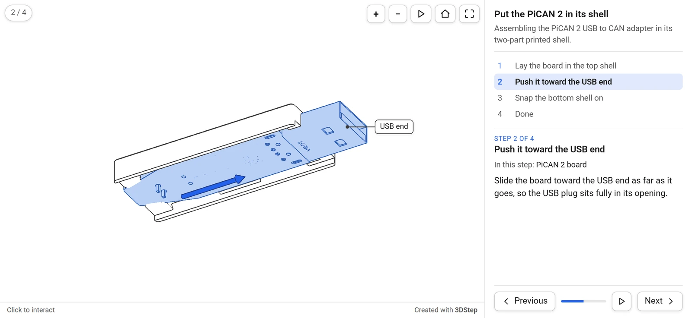
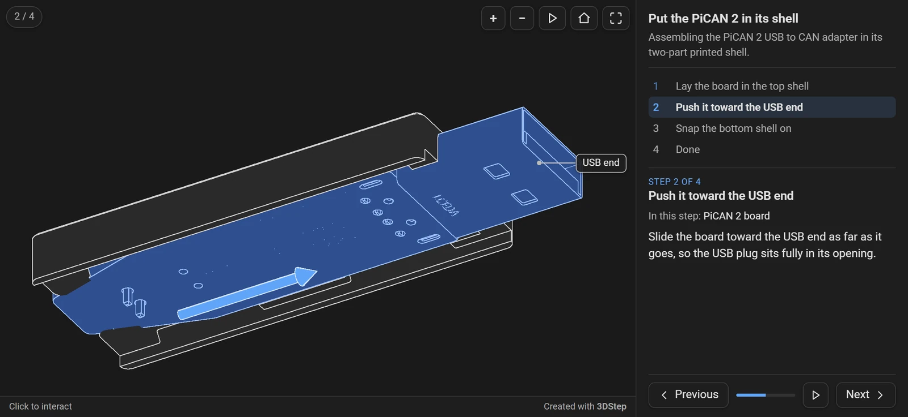
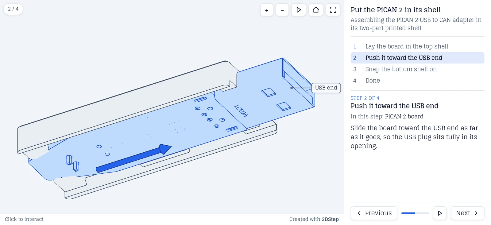
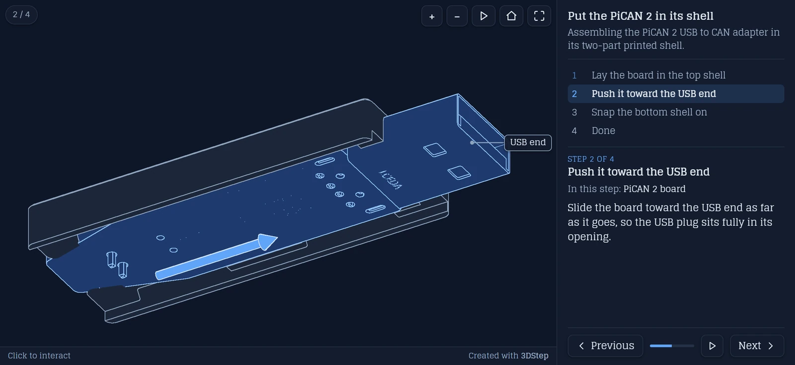
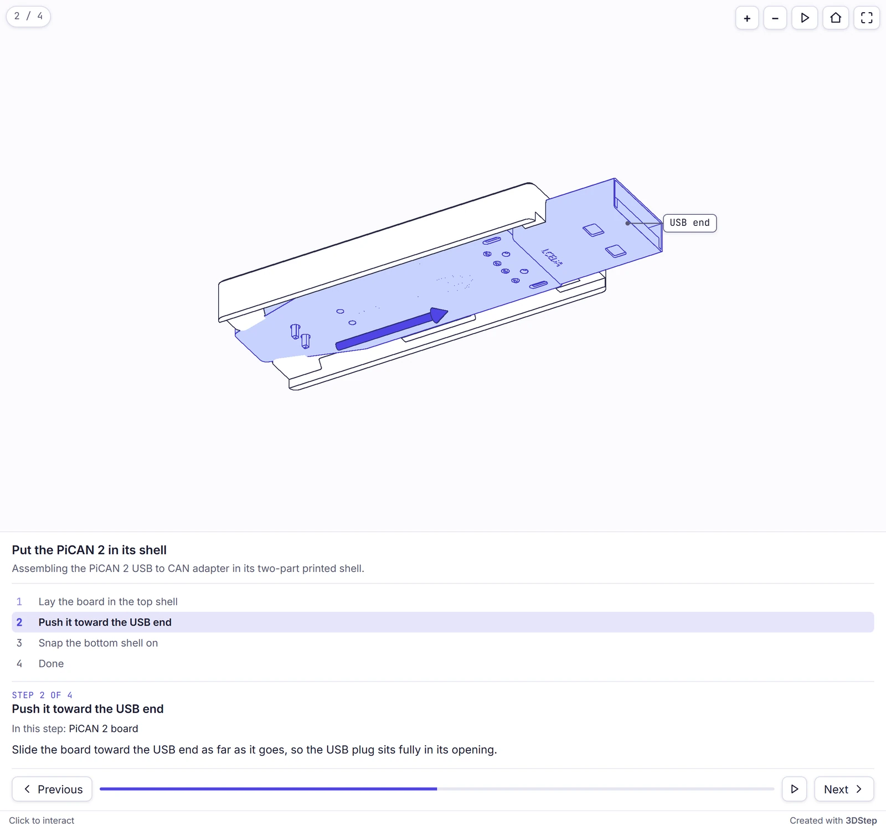
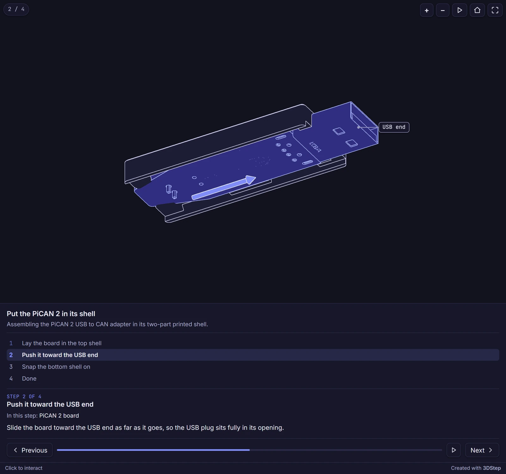
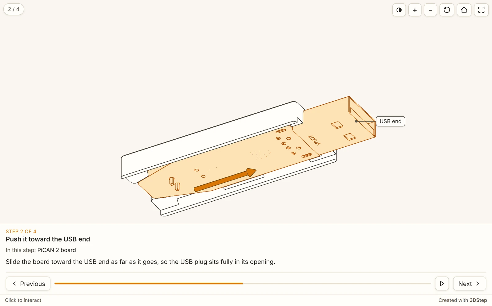
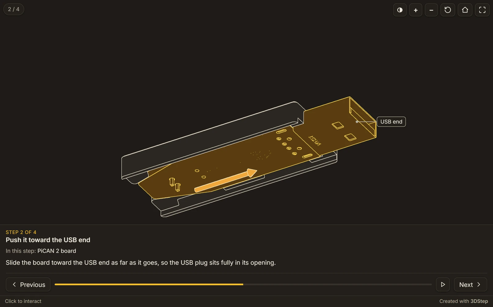

# Themes

A theme controls how a generated page looks and behaves **around** the model: the colors of the parts, edges, highlights and arrows, the step panel and its buttons, the fonts, and how the panel is laid out on wide and narrow screens. The steps themselves are project data and stay the same across themes.

Themes are bundled with `3dstep`, and you can add your own. A theme file has the same shape as a [PinConnect theme](../../pinconnect/reference/themes.md) with 3DStep's own tokens and behaviors, so a site keeps one theme file for each tool.

## Applying a theme

Set the project's theme in the `[assembly]` table of your [project file](project-toml.md):

```toml
[assembly]
title = "Mount the fan"
models = ["fan.glb"]
theme = "midnight"
```

Or override it on the command line (this wins over the project's `theme`):

```bash
3dstep assembly.toml --theme slate
```

Precedence is **`--theme` → `[assembly] theme` → `default`**. A theme name is resolved from the project's `theme_dir` (default `./themes`, next to the project) first, then from the themes bundled with the package. An unknown name is an error naming both places it looked.

## Bundled themes

| Theme | Look |
|-------|------|
| `default` | White parts with dark edges and blue highlights, Roboto. What you get with no theme. |
| `slate` | Cool gray parts with blue-gray edges on a pale slate background, Glegoo, a serif face. |
| `midnight` | An indigo accent, Inter with a monospaced font for labels, and the step panel always below the view. |
| `workbench` | Warm neutrals with an amber accent, Inter. The step text and buttons float over the bottom of the view, each step plays its moves as soon as it is shown, and a button switches between line art and shaded. |

Every theme provides both a light and a dark palette. See [Light and dark mode](#light-and-dark-mode) for how the page chooses between them.

## Light and dark mode

The generated page has no light/dark control of its own: it takes the scheme from its surroundings. In order, it follows a `?theme=dark` or `?theme=light` parameter, then the embedding page's scheme (same origin only, tracked live), then the reader's OS preference. A parent page on another origin sets it by posting `{ pinconnectTheme: "dark" }` to the iframe.

[Light and dark mode](../../guides/light-dark.md) explains each step and the message in full, and the [light and dark example](../examples/light-dark.md) shows it live.

## Theme gallery

The example project in each bundled theme, light and dark, on its second step: the board highlighted, an arrow, and a label.

### `default`

| Light | Dark |
|:-----:|:----:|
|  |  |

### `slate`

| Light | Dark |
|:-----:|:----:|
|  |  |

### `midnight`

Midnight sets `panel_placement = "below"`, so the step panel sits under the view at any width.

| Light | Dark |
|:-----:|:----:|
|  |  |

### `workbench`

Workbench sets `panel_placement = "overlay"`, `autoplay = true` and `style_toggle = true`: the step's text and buttons float over the bottom of the view, with no step list, the step's moves have already played, and the first button over the view switches between line art and shaded.

| Light | Dark |
|:-----:|:----:|
|  |  |

## Anatomy of a theme file

A theme is a TOML file whose name is the theme name (`midnight.toml` defines `midnight`). Every field is optional and **merges over the built-in defaults**, so a theme only states what differs. A minimal theme is just a name:

```toml
[theme]
name = "My Theme"
```

`name` is the display name, what the designer's Theme selector shows. It defaults to the file's own name. Projects and `--theme` always refer to a theme by its **filename**, not this.

### `[colors.light]` / `[colors.dark]`

CSS color values (hex, `rgb()`, `rgba()`, `transparent`, …). Token names are the generated CSS variables without the leading `--`. `light` applies in light mode, `dark` in dark mode.

These eleven tokens are shared with PinConnect, with the same names and defaults:

| Token | Light | Dark | What it colors |
|-------|-------|------|----------------|
| `bg` | `#ffffff` | `#131313` | Page background |
| `text` | `#1a1a1a` | `#e0e0e0` | Primary text |
| `tip-bg` | `#ffffff` | `#1e1e1e` | The step panel, the buttons and step counter over the view, and the bar under it |
| `tip-border` | `#d0d0d0` | `#3a3a3a` | The buttons' and the step counter's borders, and the note's |
| `tip-shadow` | `rgba(0,0,0,.12)` | `rgba(0,0,0,.4)` | The shadows of the buttons, the step counter and the labels |
| `hint-bg`, `hint-text` | `rgba(30,30,30,.75)`, `#fff` | `rgba(240,240,240,.85)`, `#131313` | Not used by 3DStep; accepted so a PinConnect palette can be copied over |
| `divider` | `#e5e5e5` | `#333` | Divider lines, the panel's edge, and the progress bar's track |
| `desc-color` | `#555` | `#aaa` | Secondary text: the description, the step numbers, the hint under the view, "In this step" |
| `scroll-thumb`, `scroll-track` | `rgba(0,0,0,.22)`, `transparent` | `rgba(255,255,255,.20)`, `transparent` | The step panel's scrollbar |

3DStep's own:

| Token | Light | Dark | What it colors |
|-------|-------|------|----------------|
| `accent` | `#2563eb` | `#60a5fa` | The current step, the progress bar, links, buttons on hover, the note's icon, and the outline of a viewer that is taking the mouse |
| `view-bg` | `#ffffff` | `#1a1a1a` | The 3D view's background |
| `part-fill` | `#ffffff` | `#2a2a2a` | Parts' faces in line art |
| `part-edge` | `#3a3a3a` | `#d0d0d0` | Parts' edges in line art |
| `highlight-fill` | `#b8cff5` | `#2f4f8f` | The faces of the parts a step highlights |
| `highlight-edge` | `#2f5fb3` | `#9cc0ff` | Their edges |
| `arrow` | `#2563eb` | `#60a5fa` | Arrows, unless an arrow sets its own `color` |
| `arrow-edge` | `#1e3a8a` | `#cfe2ff` | Arrows' edges in line art |
| `label-bg` | `rgba(255,255,255,.92)` | `rgba(30,30,30,.92)` | The labels' boxes |
| `label-text` | `#1a1a1a` | `#e0e0e0` | The labels' text |
| `label-line` | `#3a3a3a` | `#bbbbbb` | The labels' borders and leader lines |
| `ghost-opacity` | `0.25` | `0.3` | How opaque ghosted parts are: a number from 0 to 1, not a color |

```toml
[colors.light]
accent         = "#d97706"
highlight-fill = "#fde3b5"
highlight-edge = "#b45309"
arrow          = "#d97706"

[colors.dark]
accent         = "#fbbf24"
highlight-fill = "#5a3d10"
highlight-edge = "#fcd34d"
arrow          = "#f0a83c"
```

Setting `bg` and `view-bg` to `"transparent"` in both palettes lets an embedded page take the background of whatever it sits in, the page itself or a card, instead of painting its own. The generated page declares a `color-scheme` to match the palette it is showing, which is what browsers require before they will let an iframe stay transparent over a host page in the opposite mode. With a transparent view, the shaded style's lighting takes its colors from `bg`, or from the scheme's default view background when that is transparent too.

Names outside these tables are not rejected: they are emitted as CSS variables too. Defining `my-accent` in both palettes gives you `var(--my-accent)` to use from [`[extra_css]`](#extra_css), with light/dark switching handled for you.

Values are checked as they load. A bare hex with no `#` (`bg = "f8f8f8"`) is not valid CSS, so `3dstep` adds the `#` for you and prints a warning. A value that is no recognizable color at all (a misspelled `gray`, say) is left alone but still warned about, since it would leave that element unstyled. An empty value keeps the default, also with a warning. `ghost-opacity` must be a number from 0 to 1; a value outside is pulled in, with a warning. All of these are warnings, not errors: the page is still written. The designer shows the same warnings.

Only the tokens in the tables are checked for being a color at all. A name outside them may hold any CSS your `[extra_css]` wants, so there only the hex checks apply: a missing `#` is added, and a hex with the wrong number of digits is warned about.

### `[font]` and `[font.label]`

The UI font, and optionally a separate font for the labels, the step counter, the step numbers, the "Step N of M" line and `code` in step text.

| Key | Meaning |
|-----|---------|
| `family` | Font family name |
| `source` | `google` (loaded from Google Fonts), `bundled` (a font file embedded in the output as base64, keeping it self-contained), or `system` (`family` is used verbatim as a CSS stack) |
| `weights` | Weights to request, e.g. `"400;500;600"`: `google` only |
| `file` | Path to the font file relative to the theme, e.g. `"inter.woff2"`: `bundled` only |

Without `[font]` the page uses Roboto from Google Fonts. `[font.label]` takes the same keys and defaults to `[font]` when omitted, so without it `code` in step text is set in the UI font too.

```toml
[font]
family = "Inter"
source = "google"
weights = "400;500;600"

[font.label]
family = "JetBrains Mono"
source = "google"
weights = "400;500"
```

### `[behavior]`

| Key | Default | Effect |
|-----|---------|--------|
| `panel_placement` | `"right"` | Where the step panel goes. `"right"`: beside the view, and under it when the page is `panel_stack_breakpoint` wide or narrower. `"below"`: always under the view. `"overlay"`: the step's text and the Previous and Next buttons float over the bottom of the view, with no step list. |
| `panel_stack_breakpoint` | `760` | Width in px at or under which `"right"` moves the panel under the view |
| `panel_max_width` | `360` | The panel's width in px beside the view; never more than 40% of the page's width |
| `step_list` | `true` | List every step in the panel, to jump to any of them |
| `show_title` | `true` | Show the assembly's title and description at the top of the panel |
| `show_parts` | `true` | Name the parts a step highlights under its title ("In this step: …") |
| `viewport_aspect` | `1.6` | The 3D view's width divided by its height, from 0.1 to 10 |
| `viewport_min_height` | `320` | The view's smallest height in px |
| `viewport_max_height` | `720` | The view's largest height in px |
| `font_scale` | `1.0` | Scale the text of the panel, the buttons over the view and the labels |
| `controls` | `"full"` | `"full"`: the step panel and every button. `"minimal"`: no panel; the step counter, Previous, Play all and Next over the view, and the step's title under it. `"none"`: the view alone, which readers can still turn. `?controls=` overrides it for one embed. |
| `edge_width` | `1.0` | Line art: the edges' width in pixels, kept on high-density screens; `0` draws none |
| `edge_angle` | `35` | Line art: a crease sharper than this many degrees gets an edge, from 0 to 180 |
| `arrow_scale` | `1.0` | Multiply the size of every arrow |
| `transition_ms` | `600` | The step change and the camera's flight, in milliseconds; `0` switches at once |
| `play_ms` | `900` | How long Play takes, in milliseconds |
| `autoplay` | `false` | Play each step's moves as soon as the step is shown. `?autoplay=1` turns it on for one embed |
| `fullscreen_button` | `true` | Show a fullscreen button over the view (see below) |
| `style_toggle` | `false` | Show a button over the view that switches between line art and shaded |
| `projection_toggle` | `false` | Show a button over the view that switches between orthographic and perspective |

```toml
[behavior]
panel_stack_breakpoint = 1000
viewport_aspect        = 1.4
transition_ms          = 800
```

Numbers outside their range are pulled in rather than rejected, and a value of the wrong type, or a choice outside its list, is an error. An unknown key is a warning and is ignored, so a theme written for PinConnect still loads.

> **Narrow screens.** With `panel_placement = "right"`, the page moves its panel under the view once it is `panel_stack_breakpoint` wide or narrower, and grows to fit. Embedded with [md-iframe](../../md-iframe/embedding.md), the iframe grows and shrinks to match, also while the panel's height animates from one step to the next, with no scrollbar inside the frame. Every 3DStep page reports its height with the [auto-height protocol](../../md-iframe/auto-height.md).

> **Fullscreen.** The button puts the page into the browser's fullscreen mode, with the step's text and buttons over the view. Where element fullscreen is not available (iPhone Safari, or an embedding page whose iframe does not allow it; md-iframe's do) it opens the page in a new tab instead, on the same step and in the same scheme. The button is removed when neither can work, and `fullscreen_button = false` removes it always.

### `[extra_css]`

A raw-CSS escape hatch appended after the generated variable blocks, for anything the tokens can't express. It is emitted verbatim, so it is a trusted, author-controlled surface: keep project data out of it.

The viewer's own stylesheet comes after it, so a rule that changes something the viewer already styles needs a more specific selector than the viewer's, such as `.tds .tds-title` rather than `.tds-title`.

```toml
[extra_css]
css = """
.tds-note { font-style: italic; }
"""
```

The page's elements have classes starting with `tds-`. `[extra_css]` may also be a plain string instead of a table with `css`.

## Creating your own theme

1. Copy [`default.toml`](https://github.com/xbst/3DStep/blob/master/src/threedstep/themes/default.toml) (it documents every token and behavior) to `<name>.toml`, and uncomment and override what you want to change.
2. Put it either in the **bundled themes** folder (`src/threedstep/themes/` in a clone of the repository, shipped with the package) or in a **project-local** `theme_dir` next to your project (handy for a site theme you don't want to bundle). A project-local theme of the same name overrides a bundled one.
3. Reference it with `theme = "<name>"` (or `--theme <name>`).

A theme in the bundled folder appears in the designer's Theme selector when you reload the designer, with nothing to regenerate or restart: the designer reads the same files the renderer does.

A project-local theme reaches the designer when you open its file with the project. The designer cannot read your `theme_dir`, so open the theme's `.toml` together with the project TOML and its models, with any font file its `[font]` names, or drop them on the viewport. The designer writes them where the project's `theme_dir` points in its own file system and finds the theme exactly as the command line does: the Theme selector lists it as `<name> (project)`, the viewport previews it, and Generate gives the command line's page. Until it is opened, a project whose theme is not bundled previews with the default look, a banner offers to open the theme file, and the status bar reports the theme, as an error when it is meant to be in the default `./themes` and as a warning with another `theme_dir`. See [a site's own theme](../designer.md#a-sites-own-theme).

## A site theme

The live examples on this site use `isikstech`, a theme kept in `docs/3d/` beside the project folders rather than bundled with 3DStep. Each project names it with `theme = "isikstech"` and `theme_dir = ".."`. Its page and 3D view are transparent, so the viewer sits on the site's own background in both schemes, with the site's amber for the accent, the highlights and the arrows, and Roboto like the site:

??? example "`isikstech.toml`"

    ```toml
    --8<-- "docs/3d/isikstech.toml"
    ```

[Publish on a docs site](../../guides/publishing.md#a-shared-theme) shows the folder layout. To work on one of these projects in the designer, open `isikstech.toml` with it.

## Tips

- Because tokens merge over the defaults, start from a few overrides (`accent`, `highlight-fill`, `highlight-edge`, `arrow`) and add more only as needed.
- Keep `highlight-fill` well apart from `part-fill` in both palettes: the highlight is how a reader finds the parts a step installs.
- Check a theme on a phone: below `panel_stack_breakpoint` the panel moves under the view, and `viewport_min_height` keeps the view usable on a short screen.
- The designer shows a **Theme** selector in its toolbar; a theme name it doesn't know about is still kept when you save.
