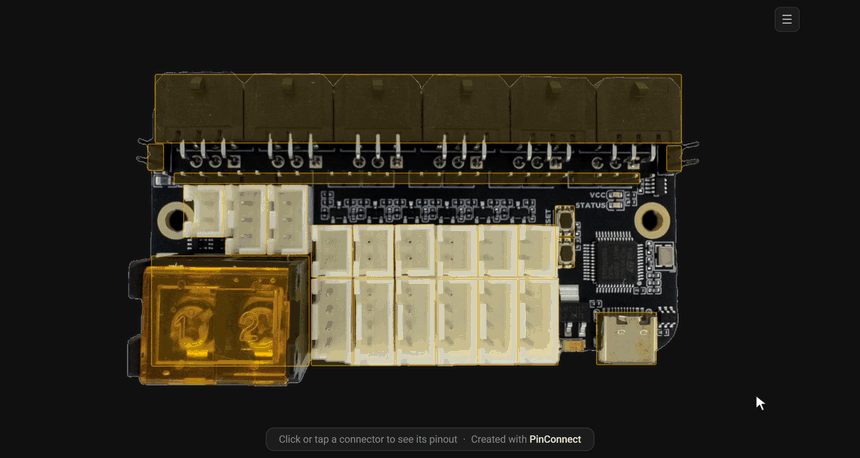

# Isik's Tech Documentation Tools

Open-source tools for writing better hardware documentation. Initially built for [Isik's Tech docs](https://docs.isiks.tech), open-sourced so others can use them too.

-    ## PinConnect
    ---
    
    PinConnect turns a photo of a circuit board into an interactive pinout: hover or tap a connector to see its pinout. Make one in the browser at [pinconnect.isiks.tech](https://pinconnect.isiks.tech), or render it from a config on the command line.
    
    === "Animated demo"
        
         
        *A generated pinout for the [Birds' Nest CAN](https://store.isiks.tech/products/birds-nest-CAN) board — hover a connector on the board for its pinout, or open the connector list to browse every connector at once.*
    
    === "Interactive pinout"
        { type=iframe }
        
        *Above pinout was generated for [OwlFC-Mini docs](https://docs.isiks.tech/owlfc-mini/manual/#pinout) using PinConnect with a custom theme, embedded with [md-iframe](#md-iframe).*

    ---
    
    [Documentation](pinconnect){ .md-button .md-button--primary } [Repo](https://github.com/xbst/PinConnect){ .md-button }

<!--- 3DStep goes here --->

-     ##md-iframe
    ---
    A Python-Markdown extension for MkDocs and Zensical sites. It turns an image-style tag into an `<iframe>` that sizes itself to the page inside it and shows a visible error when the file is missing. Supports syncing dark/light mode and automatic resizing.
     
     ---
     
    [Documentation](md-iframe){ .md-button .md-button--primary } [Repo](https://github.com/xbst/md-iframe){ .md-button }

!!! info "Coming from `pinout-gen` or `pinout-embed`? Nothing breaks; see [Migrating from the old names](migration.md)."

## License

PinConnect and md-iframe are licensed under GPL-3.0. Their source is on GitHub: [xbst/PinConnect](https://github.com/xbst/PinConnect) and [xbst/md-iframe](https://github.com/xbst/md-iframe).
