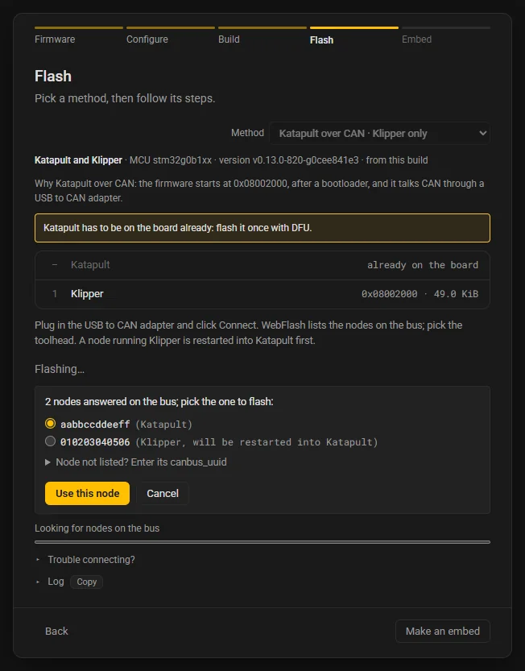

# Flashing methods

WebFlash writes firmware from the browser through the chip's own ROM bootloader (DFU on an STM32, PICOBOOT or the UF2 drive on an RP2040 or RP2350) or through Katapult, the bootloader a Klipper board often carries in its first kilobytes. This page says what each method needs, how to get the board into the right mode, and what each operating system wants before the browser may use the board. The [Flash step](site/flash.md) describes the buttons; [Troubleshooting](troubleshooting.md) the errors.

## Browsers

Flashing needs **Chrome or Edge on a computer**, over HTTPS or from `localhost`: the methods talk to the board through WebUSB and Web Serial, and the UF2 drive through the File System Access API.

- **Brave** runs every method but the UF2 drive: it ships with the File System Access API off. Turn on `brave://flags/#file-system-access-api` and restart Brave, or download the `.uf2` and copy it onto the drive yourself.
- **Firefox and Safari** have no WebUSB and no Web Serial. They configure and build, and the Flash step offers the files to download.
- **Chrome on Android** has WebUSB but no Web Serial and no folder picker, so the Flash step offers DFU and PICOBOOT there, with the board on a USB OTG adapter. No board has been flashed from Android so far.

## The methods at a glance

| Method | Id in the board TOML | For | Needs |
|---|---|---|---|
| [DFU (STM32 ROM)](#dfu) | `dfu` | STM32 chips whose ROM has USB DFU | the board's USB port; on Windows, WinUSB only if the browser cannot open it |
| [PICOBOOT (RP2 BOOTSEL)](#picoboot) | `picoboot` | RP2040, RP2350 | the board's USB port; WinUSB for the RP2040 on Windows |
| [UF2 drive (RP2 BOOTSEL)](#the-uf2-drive) | `uf2` | RP2040, RP2350 | the board's USB port; Chrome or Edge's folder picker |
| [Katapult (USB or UART)](#katapult-over-usb) | `katapult` | any board with Katapult on USB or a UART | Web Serial |
| [Katapult over CAN](#katapult-over-can) | `katapult-can` | a CAN node with Katapult | a USB to CAN adapter or a Klipper USB to CAN bridge board |
| [Download the files](#download) | `download` | everything | your own tool, or the SD card |

The id is what a board TOML writes in `[flash] methods` (or a setup's `methods`) and as a key of `[flash.instructions]`:

```toml
[flash]
methods = ["katapult", "dfu", "download"]

[flash.instructions]
dfu = "Hold BOOT, tap RESET, release BOOT, then click Connect."
```

## How the methods are picked

The Flash step reads the methods from the firmware's resolved `.config`: the chip, the communication interface, and whether the firmware starts after a bootloader (its application address is not the start of the flash).

- **Klipper or Kalico with a bootloader offset** gets Katapult first: over CAN for a CAN build, over Web Serial for a USB build, a UART build and a USB to CAN bridge (which runs Katapult on its own USB port). Then the chip's ROM method, then Download.
- **Without a bootloader offset** it gets the ROM method, then Download.
- **The ROM method** is DFU on an STM32 whose ROM has USB DFU, whatever interface the firmware itself uses: a CAN toolhead with a USB port is flashed through the ROM like any board ("over the board's USB port, if it has one"). On an RP2040 or RP2350 it is PICOBOOT, then the UF2 drive.
- **Katapult itself** is flashed with the chip's ROM method only (DFU, or PICOBOOT and the UF2 drive), never with Katapult.
- **An LPC176x** gets Download first (the SD card) and, for a firmware at 16 KiB, Katapult. **SAM, SAMD and HC32F460** builds get Download only: WebFlash builds them but does not flash them from the browser.
- An uploaded Klipper file brings its own configuration in its dictionary (the micro-controller, the interface's pins, the CAN bitrate, the address), so a file decides its own methods.

The board TOML's `[flash] methods`, or the setup's own `methods`, then keeps only the methods it lists, in its order. See [`[flash]`](reference/board-toml.md#flash) in the board TOML reference.

## DFU

The STM32's ROM bootloader, over USB. It writes anywhere in the flash, so it installs Katapult, writes a Klipper without a bootloader, or writes a Klipper built for a bootloader offset at that offset (only the pages the image covers are erased, so a Katapult already in front of it stays).

**Which chips.** The STM32 families whose ROM has USB DFU: the F042, F072, F4, F7, G0 (except the G070 and G071, which have no USB), G4, L4 and H7 (and Kalico's AT32F403). WebFlash treats every other STM32 (the F103, F207, F031 and F070, for example) as having none: their builds get Katapult (with a bootloader offset) or Download.

**Enter the bootloader.** Plug the board in over USB, hold BOOT0 (often labeled BOOT), tap RESET, release BOOT0. The board shows up as "DFU in FS Mode" in Chrome's picker on newer ROMs, or as "STM32 BOOTLOADER", both `0483:df11`.

**The steps.**

1. Plug the board in over USB.
2. Hold BOOT0, tap RESET, release BOOT0.
3. Click **Connect** and pick "DFU in FS Mode".

**Restart Klipper into the bootloader.** For a board running Klipper on a USB serial port, this button does the BOOT0 dance for you: pick Klipper's port and WebFlash sends the 1200-baud touch, which makes Klipper restart into its bootloader. It is offered only when the firmware's Klipper runs a USB serial port, not for a UART, CAN or USB to CAN bridge build, which the touch cannot reach. Klipper decides where it restarts: a Klipper behind Katapult restarts into Katapult, not into the ROM, so for such a board use BOOT0 and RESET.

!!! note "A bootloader that stays busy"
    A DFU bootloader that stays busy for over 30 seconds fails the flash with "The bootloader stayed busy … for over 30 s" rather than waiting forever: unplug the board, put it back in its bootloader, click **Connect** and flash again.

A chip with read-out protection on refuses the read-back; see [Troubleshooting](troubleshooting.md#the-chip-is-read-protected).

## PICOBOOT

The RP2040's and RP2350's BOOTSEL ROM, over USB. Like DFU it writes anywhere in the flash, erasing only the sectors the image covers, reads it back and restarts the chip.

**Enter the bootloader.** Hold BOOTSEL while plugging the board in (or hold BOOTSEL and tap RESET on a board that has both). The board shows up as "RP2 Boot" (`2e8a:0003` for the RP2040, `2e8a:000f` for the RP2350), and as a drive at the same time.

**The steps.**

1. Hold BOOTSEL and plug the board in.
2. Click **Connect** and pick "RP2 Boot".

**Restart Klipper into the bootloader** works as under DFU: a Klipper without a bootloader offset restarts into BOOTSEL.

## The UF2 drive

The same BOOTSEL ROM, through the drive it shows: `RPI-RP2` on an RP2040, `RP2350` on an RP2350. WebFlash writes one `.uf2` file onto the drive, and the ROM writes it to the flash and restarts. Nothing is read back: the board restarts by itself once it has the whole file, and the drive goes away.

**The steps.**

1. Hold BOOTSEL and plug the board in.
2. Click **Pick the drive** and choose `RPI-RP2` (or `RP2350`). The browser asks whether the site may edit files in it; allow it.
3. The board restarts by itself.

The step reads the drive's `INFO_UF2.TXT` when you pick it, so the confirmation names the board ("RPI-RP2 BOOTSEL drive (Raspberry Pi RP2, UF2 Bootloader v3.0)") and a folder that is no BOOTSEL drive is refused before anything is written.

<!-- screenshot: Chrome's folder picker with the RPI-RP2 drive selected, and the "let site edit files" prompt -->

- **Chrome and Edge only.** The folder picker is the File System Access API, which Firefox, Safari and Android do not have and Brave turns off by default. **Download .uf2** beside **Pick the drive** saves the file to copy onto the drive yourself.
- **Not in a frame from another site.** Browsers open no folder picker in a page embedded from another origin, so a card embedded that way offers the `.uf2` as a download. See [Embedding a card](embedding.md).
- **The RP2350's family.** A UF2 names the chip family it is for, and the RP2350's ROM ignores blocks for the RP2040. WebFlash writes the RP2350 family (Arm, secure) into the `.uf2` of an RP2350 build. Klipper's own `elf2uf2` stamps the RP2040 family on every RP2 build, so an uploaded RP2040-family `.uf2` whose first 4 KiB hold an RP2350 image block is treated as an RP2350 image and encoded again for the RP2350's drive. A `.uf2` for another chip family altogether (a SAMD51's, say) is offered only as a download.

!!! note "RP2350 boards"
    No RP2350 board has been flashed with WebFlash yet: the RP2350 paths have run against the mocks and in the build checks only.

## Katapult over USB

[Katapult](https://github.com/Arksine/katapult) on the board's USB port, through Web Serial. Katapult writes the firmware after itself, at its application address, and never over itself, so a write that breaks off leaves the board in Katapult, ready for another try.

**Enter Katapult.**

- **From Klipper**: click **Restart Klipper into Katapult** and pick Klipper's port (`1d50:614e`). WebFlash sends the 1200-baud touch, Klipper restarts into Katapult, and the step waits up to 10 seconds for the Katapult port (`1d50:6177`), or asks you to pick it.
- **By hand**: double-tap RESET, if Katapult was built with "Support bootloader entry on rapid double click of reset button" (on by default). Then click **Connect** and pick the Katapult port.

**The steps.**

1. Klipper running? Click **Restart Klipper into Katapult**.
2. Otherwise, double-tap RESET to start Katapult.
3. Click **Connect** and pick the Katapult port.

The firmware must be built for Katapult's application address (the bootloader offset in Klipper's Configure, which WebFlash sets for you when Katapult is built beside it). Katapult refuses a file that starts elsewhere, with a sentence saying so.

A USB to CAN bridge board also runs Katapult on its own USB port. **Restart Klipper into Katapult** does not reach a bridge, which has no USB serial port; double-tap RESET, or use [Katapult over CAN](#katapult-over-can) and pick the bridge's own node.

## Katapult over UART

Katapult built for a serial interface, reached through a USB-UART adapter (a CH340, CP2102 or FTDI cable, TX to RX, RX to TX, GND to GND). The Flash step uses it for a firmware whose interface is serial.

!!! warning "Not run on a board yet"
    Katapult over UART has run against the mocks only; no board wired for UART has been flashed with it so far.

- **Every serial port is listed.** An adapter has no Katapult id, so **Connect** shows every serial port; pick the adapter's.
- **One baud rate.** The adapter is opened at the firmware's `CONFIG_SERIAL_BAUD` (from the `.config`, or from an uploaded file's dictionary), else 250000, Klipper's and Katapult's default. That rate serves Klipper's restart request and Katapult alike, so Katapult must be built with the same baud as the firmware. The steps say so: "Katapult must talk at 250000 baud too."
- **Restart Klipper into Katapult** picks the adapter's port and sends Klipper's serial bootloader request at that baud (not the 1200-baud touch, which an adapter cannot carry to the board). Katapult then answers on the same port.

**The steps.**

1. Klipper running? Click **Restart Klipper into Katapult**.
2. Otherwise, double-tap RESET to start Katapult.
3. Click **Connect** and pick the adapter's port.
4. Katapult must talk at 250000 baud too (or the firmware's own rate).

## Katapult over CAN

Katapult on a CAN node, such as a toolhead board, reached through a USB to CAN adapter on this computer:

- a **candleLight (gs_usb) adapter**, such as a CANable (`1d50:606f`), or another gs_usb adapter WebFlash knows (`1209:2323`, the CES CANext FD, the ABE CANdebugger FD, the Xylanta SAINT3);
- a **Klipper board in USB to CAN bridge mode**, which shows up as the same gs_usb device.

**The bus speed must match.** The adapter is started at the firmware's CAN bus speed (`CONFIG_CANBUS_FREQUENCY`, 1 Mbit/s by default; an uploaded file's dictionary says its own), and every node on the bus, Katapult included, must use that speed.

**The steps.**

1. Plug in the USB to CAN adapter.
2. Click **Connect** and pick the adapter.
3. Pick the node; Klipper restarts into Katapult.

After **Flash**, WebFlash clears the nodes' ids (as Katapult's `flashtool.py` does, so a node left with an id by an attempt that broke off is found again), asks the bus who is there, and lists the nodes that answer, each with what it runs. A node running Klipper is sent the bootloader request and comes back as Katapult. Pick one and click **Use this node**.



**A node a running host holds.** Klipper under a running host does not answer the query, but it does restart into Katapult when asked by its UUID. When no node answers, the list says "No node answered on the bus." and **Node not listed? Enter its canbus_uuid** is open: type the node's `canbus_uuid` from `printer.cfg` (12 hex digits, like `aabbccddeeff`; spaces, colons and dashes are fine) and click **Use this UUID**. Without a node and without a UUID, the step fails with "No node answered on the bus: check the bus speed, the wiring, the termination and the power, or stop Klipper on the host."

**The bridge itself.** When the adapter is a Klipper bridge board and you pick the bridge's own node, the bridge restarts into Katapult on its own USB port: the Flash step switches to Katapult over USB, and you connect again to finish.

On Linux, the kernel's `gs_usb` driver holds the adapter until you release it; see [Linux](#linux).

## Download

**Download the files** saves the build's files (or the uploaded file) for any other tool: an ST-LINK, `dfu-util`, `picotool`, OpenOCD, `bossac`, Katapult's `flashtool.py`. It is always in the list, and it is what a browser without WebUSB and Web Serial gets.

The default steps follow the chip: "Download the files. Flash them with your board's own tool."; for SAM and SAMD "Download klipper.bin. Flash it with bossac (as `make flash` does)."

### The SD card (LPC176x)

LPC176x boards (and many others) load `firmware.bin` from the SD card at power-up:

1. Download `klipper.bin`.
2. Copy it to the SD card as `firmware.bin`.
3. Power the board up with the card in.

The board's bootloader renames the file once it has flashed it (to `FIRMWARE.CUR` on most LPC176x boards). Katapult also runs on an LPC176x when it is installed in the first 16 KiB; a Klipper built for 16 KiB then gets Katapult as a method too.

## Klipper and Katapult together

With Katapult ticked beside Klipper or Kalico on page 1, both are built and flashed as one firmware: Katapult at its flash start, the firmware at its application address.

**The first time: one session through the ROM.** DFU, PICOBOOT and the UF2 drive write both parts in one session, and say **· flashes both at once** in the Method select. The UF2 drive gets one `.uf2` encoded from both parts, never two files joined. After it, the board runs the firmware through the new Katapult.

**Later updates: Katapult's own methods.** Katapult over USB, UART or CAN write the firmware alone, onto the Katapult already on the board: they say **· Klipper only** (or Kalico). The write list marks Katapult as already on the board, and a notice says how it gets there when it is not.

**Without a ROM method (LPC176x).** An LPC176x pair has no "flashes both at once" method, so Katapult goes on first by other means, and the Download steps say how:

- with a `deployer.bin` in Katapult's build: download `deployer.bin`, copy it to the SD card as `firmware.bin`, power up once with the card in; then flash the firmware through Katapult;
- without one: download `katapult.bin` and write it with an SWD or ISP tool; then flash the firmware through Katapult.

## Drivers and permissions

The browser may only use a device the operating system lets it open. What each system wants, once per device:

| | Windows | Linux | macOS |
|---|---|---|---|
| DFU (`0483:df11`) | usually nothing; WinUSB via Zadig if the browser cannot open it | a udev rule | nothing |
| PICOBOOT (`2e8a:0003`, `2e8a:000f`) | WinUSB via Zadig for the RP2040 | a udev rule | nothing |
| UF2 drive | nothing | nothing | nothing |
| Katapult over USB or UART | nothing | the `dialout` group | nothing |
| Katapult over CAN, candleLight or bridge | nothing (WinUSB with Zadig only if the adapter has none) | unbind `gs_usb`, and a udev rule | nothing |

The hardware runs so far were on Windows; the Linux and macOS entries are what the error messages advise, and have not been run on a board yet.

### Windows

PICOBOOT on an RP2040 needs the WinUSB driver once, which [Zadig](https://zadig.akeo.ie) installs. The STM32's DFU bootloader needed no driver on the boards tried so far; if the browser lists it but cannot open it, install WinUSB on it the same way:

1. Put the board in its bootloader and plug it in.
2. Open Zadig and tick **Options > List All Devices**.
3. Pick the device: "DFU in FS Mode" or "STM32 BOOTLOADER" for an STM32 in DFU, "RP2 Boot (Interface 1)" for an RP2040 in BOOTSEL (not interface 0, the drive).
4. Choose **WinUSB** as the driver and click **Replace Driver** (or **Install Driver**).
5. Replug the board, then click **Connect** again.

<!-- screenshot: Zadig with "List All Devices" ticked, "DFU in FS Mode" picked and WinUSB as the target driver -->

Without WinUSB, Chrome lists the device in its picker but cannot open it: the step gives up after 10 seconds with "The device is listed but cannot be used, which on Windows means its interface has no WinUSB driver", and the Zadig steps.

STM32CubeProgrammer installs its own driver (STTub30) for the DFU device; replace it with WinUSB in Zadig. STM32CubeProgrammer then uses WinUSB too.

Katapult over USB and UART, and candleLight adapters, need no driver: Windows has them already.

### Linux

**Serial ports (Katapult over USB or UART).** Add your user to the `dialout` group, then log out and back in:

```bash
sudo usermod -a -G dialout $USER
```

Stop anything else holding the port: Klipper, and ModemManager, which opens new serial ports to probe them.

**USB devices (DFU, PICOBOOT, a CAN adapter).** Give the browser access with a udev rule in `/etc/udev/rules.d/70-webflash.rules`, one line per device:

```text
SUBSYSTEM=="usb", ATTR{idVendor}=="0483", ATTR{idProduct}=="df11", MODE="0666", TAG+="uaccess"
SUBSYSTEM=="usb", ATTR{idVendor}=="2e8a", ATTR{idProduct}=="0003", MODE="0666", TAG+="uaccess"
SUBSYSTEM=="usb", ATTR{idVendor}=="2e8a", ATTR{idProduct}=="000f", MODE="0666", TAG+="uaccess"
SUBSYSTEM=="usb", ATTR{idVendor}=="1d50", ATTR{idProduct}=="606f", MODE="0666", TAG+="uaccess"
```

Then reload the rules and replug the board:

```bash
sudo udevadm control --reload-rules && sudo udevadm trigger
```

Quit `dfu-util` or STM32CubeProgrammer if one of them holds the device.

**A CAN adapter.** The kernel's `gs_usb` driver owns a candleLight adapter or a bridge board as `can0`, and the browser cannot claim it while it does. Release it before **Connect**:

1. Stop a Klipper host that uses the adapter.
2. Take the interface down: `sudo ip link set can0 down`
3. Unbind the driver: `echo <name> | sudo tee /sys/bus/usb/drivers/gs_usb/unbind`, where `<name>` is the adapter's entry in `/sys/bus/usb/drivers/gs_usb/`, like `1-3:1.0`.
4. After flashing, replug the adapter: the kernel binds it again.

### macOS

macOS needs no driver for any method. If the browser cannot open a device, quit the program holding it: `picotool`, `dfu-util`, STM32CubeProgrammer or Klipper.

## Getting into the bootloader

| Method | By hand | From a running Klipper |
|---|---|---|
| DFU | hold BOOT0, tap RESET, release BOOT0 | **Restart Klipper into the bootloader** (a Klipper on USB without a bootloader offset) |
| PICOBOOT, UF2 drive | hold BOOTSEL while plugging in | **Restart Klipper into the bootloader** under PICOBOOT (a Klipper on USB without a bootloader offset) |
| Katapult over USB | double-tap RESET | **Restart Klipper into Katapult** (the 1200-baud touch) |
| Katapult over UART | double-tap RESET | **Restart Klipper into Katapult** (Klipper's serial bootloader request) |
| Katapult over CAN | double-tap RESET | pick the node, or type its `canbus_uuid`: WebFlash sends the bootloader request |

After a restart from Klipper the board comes back with another USB identity, which the browser treats as a new device: the step finds it by itself only when this site was allowed to use it before, and otherwise asks you to pick it.
