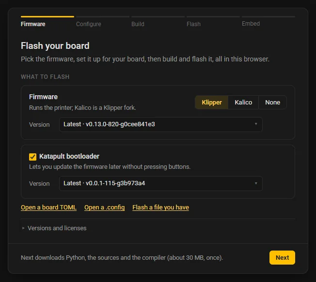
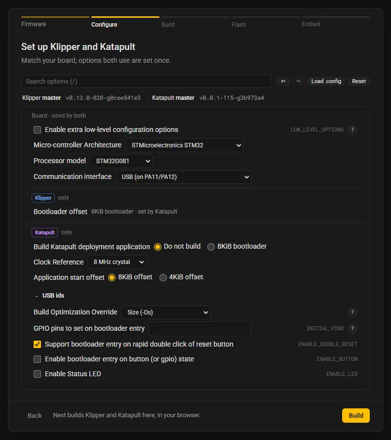
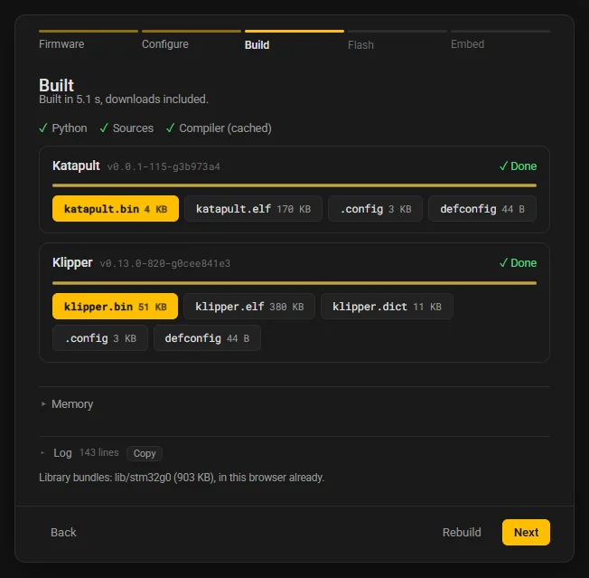
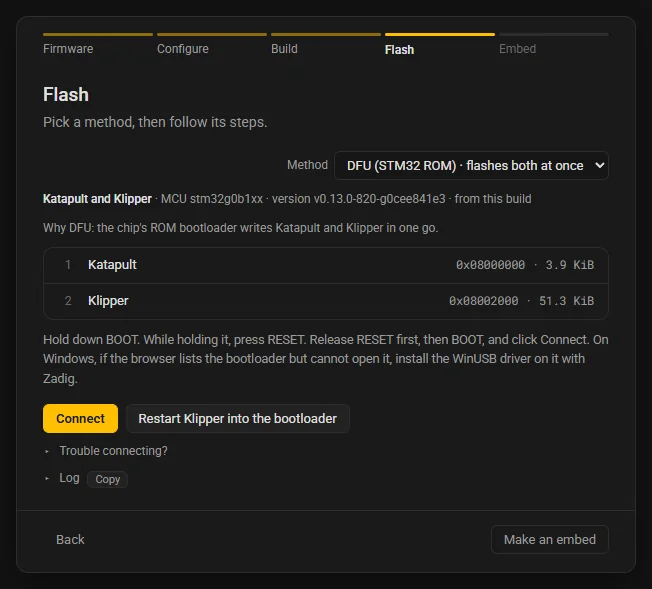
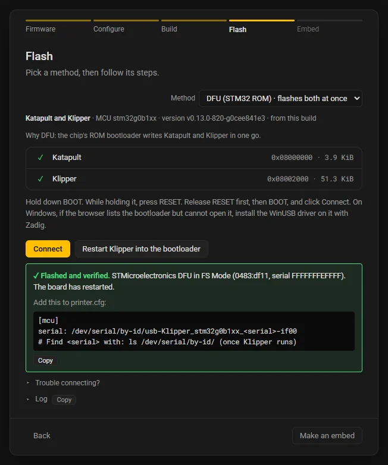

# Getting started

This guide takes one board through the whole site: an STM32G0B1 board on USB, with Klipper and, if you want it, the Katapult bootloader. You pick the firmware, set it up for the board, build it in the browser and flash it over USB. Nothing is installed, and nothing you configure or build leaves the browser.

The site has five steps, shown in the bar at the top of its box: **Firmware**, **Configure**, **Build**, **Flash** and **Embed**. This page walks through the first four; the step pages ([Firmware](site/firmware.md), [Configure](site/configure.md), [Build](site/build.md), [Flash](site/flash.md) and [Embed](site/embed.md)) cover every control.

## What you need

- **Chrome or Edge on a computer** (Windows, macOS or Linux). Flashing uses WebUSB and Web Serial, which only Chromium browsers have. Firefox configures, builds and downloads the files, but cannot flash them. See [Chips, methods and browsers](reference/support.md).
- **A USB cable** to the board, and a way to put the board in its bootloader: on most STM32 boards a BOOT0 button or jumper and a RESET button.
- **About 30 MB of downloads** the first time: Python, the firmware's sources and the compiler. The browser keeps them, so the next visit downloads nothing.

## Step 1: Open the site

Go to **<https://webflash.isiks.tech>**. The site opens on **Firmware**, the first page.

To run the site on your own computer instead, see [Run it locally](#run-it-locally) below.

## Step 2: Pick the firmware



Under **What to flash**:

1. Pick **Klipper** (or **Kalico**, a Klipper fork) in the firmware switch.
2. Leave its **Version** at **Latest** unless you need another one. Latest is the newest snapshot of the project's default branch that passed WebFlash's build check. To match what your printer's host runs, paste the version Mainsail or Fluidd shows into the picker; [Versions](site/firmware.md#versions) explains the list.
3. Tick **Katapult bootloader** if you want Katapult on the board. Katapult sits in the first few KB of flash and lets you update Klipper later over USB (or CAN) without pressing buttons. With it ticked, WebFlash builds Katapult and Klipper together and flashes both in one go. Leave it unticked to flash Klipper alone.

The hint by **Next** says what Next downloads and how much, for example "Next downloads Python, the sources and the compiler (about 30 MB, once)." Click **Next**: that is your go-ahead for the downloads. Python and the sources load first, and the compiler downloads in the background while you configure. The status chip at the top of the page shows how far each one is.

## Step 3: Configure



**Configure** shows every option of `make menuconfig` for the version you picked, read from the project's own Kconfig files. A new board starts as an STM32G0B1 with **Enable extra low-level configuration options** on, so for this board most of the work is checking a few lines:

- **Micro-controller Architecture**: STMicroelectronics STM32.
- **Processor model**: STM32G0B1.
- **Clock Reference**: the crystal your board has, for example **8 MHz crystal**. Your board's documentation or its Klipper sample config names it.
- **Communication interface**: **USB (on PA11/PA12)** for a board on USB.
- **Bootloader offset** (Klipper only): with Katapult ticked, this line is locked and follows Katapult's **Application start offset** ("8KiB bootloader · set by Katapult"). Without Katapult, pick **No bootloader** to flash Klipper at the start of flash, or the size of the bootloader already on your board. Klipper's default for this chip is **8KiB bootloader**, which is Katapult's size.

With Katapult ticked the page is split in three groups: **Board · used by both** holds the options both projects use, set once for both; **Klipper only** and **Katapult only** hold the rest. Katapult's own options (double-click reset to enter it, a status LED) are under **Katapult only**.

Use the search box (or press `/`) to find an option by its name, its prompt or its help text, and the **?** beside an option for its help. **Undo** and **Redo** (Ctrl+Z and Ctrl+Y) step back through your changes. [Configure](site/configure.md) covers the rest, including loading a `.config` you already have.

Click **Build**.

## Step 4: Build



The build starts by itself. Each firmware gets a row (Katapult first) with its progress, and the line above them checks off what the build needs: Python, the sources and the compiler. The first build may wait a few seconds for the compiler to finish downloading; after that a build takes a few seconds.

When it is done, each row shows **Done** and its files as buttons, such as `katapult.bin`, `klipper.bin` and `klipper.elf`. Click one to download it. **Memory** shows how much flash and RAM each firmware uses, and **Log** holds every command the build ran. See [Build](site/build.md).

Click **Next**.

## Step 5: Flash

The **Flash** step lists the ways this firmware can be written to the board, in the **Method** select, with the steps for the one picked. This guide uses the chip's ROM bootloader over USB, **DFU (STM32 ROM)**, which every STM32G0B1 has and which needs nothing on the board already. With Katapult and Klipper built together it is the first method and reads "DFU (STM32 ROM) · flashes both at once", and the list under it shows the two writes: Katapult at the start of flash and Klipper after it. For Klipper alone with **No bootloader** it is the first method too; for Klipper alone behind a bootloader offset, Katapult's method comes first (for a board that has Katapult already), and DFU is in the select after it.



1. Plug the board in over USB.
2. Put it in its bootloader: hold BOOT0, tap RESET, release BOOT0.
3. Click **Connect**. The browser opens its device picker: pick "DFU in FS Mode" and click **Connect** there.
4. Click **Flash Katapult and Klipper** (or **Flash Klipper** without Katapult). WebFlash erases what it writes, writes, reads it back to verify, and starts the board.

On Windows the DFU bootloader usually needs no driver. If the step says the device is listed but cannot be used, install the WinUSB driver on it with Zadig, as [Windows](flashing.md#windows) describes, and click **Connect** again.

<!-- screenshot: Chrome's USB device picker with "DFU in FS Mode" -->

When it is done the step says "✓ Flashed and verified." and shows the lines to add to your `printer.cfg`:



```ini
[mcu]
serial: /dev/serial/by-id/usb-Klipper_stm32g0b1xx_<serial>-if00
# Find <serial> with: ls /dev/serial/by-id/ (once Klipper runs)
```

The browser cannot see the serial number Klipper reports, so run that `ls` on your printer's host once Klipper runs and copy the full name.

With Katapult on the board, later updates need no buttons: configure and build again, pick **Katapult (USB or UART)** on the Flash step, and click **Restart Klipper into Katapult**, which asks the running Klipper to restart into Katapult. That method writes Klipper alone. If something goes wrong, the step lists fixes for your system and browser; [Flash](site/flash.md) and [Troubleshooting](troubleshooting.md) have more.

## Make a card for your board

If you document a board, you can give its readers the same flow on your own docs page: a card that builds and flashes your board's firmware with your settings. Click **Make an embed** on the Flash step (or **Embed** in the step bar from anywhere). There you choose what the reader may change, save the board TOML and generate the page. See [Embed](site/embed.md) for the step and [Embedding a card](embedding.md) for putting the card on a docs site.

## Open a board TOML

A board TOML holds a board's whole setup: the firmware, its versions, the configuration and how to flash it. If someone already wrote one for your board, you can skip page 1 and most of Configure:

- **From a docs page:** a WebFlash card has an **Open in WebFlash** link. It opens the site with the board TOML in the link, ready on **Configure**.
- **From a file:** click **Open TOML** in the top bar (or **Open a board TOML** on page 1) and pick the `.toml`, with its image and firmware file if it names them.

Opening a TOML loads its configuration at once. Check it, then go on to **Build** as above. A TOML that flashes a prebuilt file goes straight to **Flash**.

## Run it locally

The site is also part of the `webflash` command line tool. Install it with Python 3.9 or newer and run it with no arguments:

```bash
pip install "git+https://github.com/xbst/webflash.git@master"
webflash
```

That builds what the site needs, starts a local server on a free port and opens your browser on it. Add `--port 8000` to choose the port and `--no-browser` to leave the browser alone. The toolchain and the sources still come from <https://webflash.isiks.tech> unless you point `--assets` at another place. See [Command line and CI](command-line.md).

The site must be served over HTTP: opening its `index.html` from disk does not work.

## Where to go next

- [Firmware](site/firmware.md): the top bar, page 1 and every way to pick a version.
- [Configure](site/configure.md): the options, Klipper and Katapult together, `.config` files and setups.
- [Flashing methods](flashing.md): DFU, PICOBOOT, the UF2 drive, Katapult over USB, UART and CAN, and drivers per system.
- [Embedding a card](embedding.md): put a board's card on your docs site.
