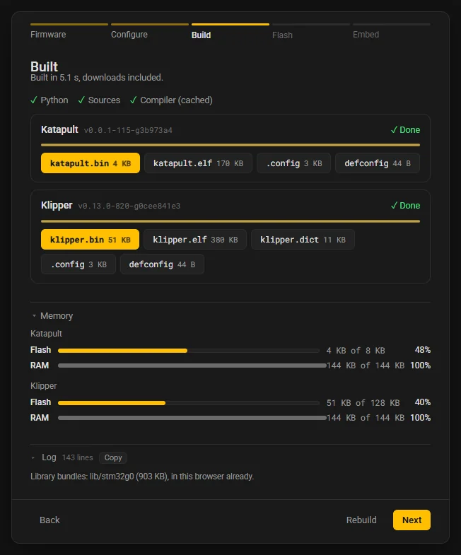

# How it builds

WebFlash builds Klipper, Kalico and Katapult in the browser without a server doing the work and without a copy of their build system written in JavaScript. It runs each project's own Kconfig files, Makefiles and Python scripts, and compiles with clang and lld built to WebAssembly. This page is for readers who want to know what runs, why the result is not GCC's, and how to check it.

## What runs in the browser

### Python in a worker

The site and every card load the `webflash` Python package into [Pyodide](https://pyodide.org), Python built to WebAssembly, in a Web Worker, so the page stays responsive while it works. The worker boots on first need (page 1's **Next**, opening a board TOML, Generate), downloads Pyodide from jsDelivr (about 7 MB, kept by the browser's HTTP cache), and fetches the package as one small zip, `webflash.zip`, from the site. The command line and the site run the same package, which is why the site's Generate writes the command line's bytes.

### The firmware sources

The site never fetches from GitHub. It downloads [source snapshots](#the-source-snapshots) from its own origin: for the version you pick, a core bundle (the Kconfig files, the Makefiles, `src/`, the scripts) and, once a configuration names them, the `lib/<dir>` bundles it needs (an STM32's CMSIS headers, the RP2040's SDK parts). A build of an STM32G0B1 fetches about 1.5 MB of sources, an STM32H723 about 5 MB. The worker unpacks them at `/webflash/src/<project>/<commit>` in its own file system.

### The project's own build, interpreted

Configuring runs the kconfiglib each project bundles in `lib/kconfiglib`, never a copy of WebFlash's, so the menu, its defaults and its dependencies are exactly what `make menuconfig` shows for that commit, and the `.config` and defconfig are what `make olddefconfig` and `make savedefconfig` write.

Building runs the project's `Makefile` through WebFlash's own make interpreter, which has GNU make's semantics: variable flavors, functions, includes, pattern rules and recipe order. Nothing is special-cased for a project; a construct the interpreter does not know is an error that names the file and the line, which the [snapshot gate](#the-snapshot-gate) relies on to catch an upstream change before a reader meets it. Recipe lines go to a small shell emulation that handles the commands the Makefiles use (`echo`, `mkdir -p`, `rm -f`, `cp`, `cat`, `tr`, `test`, a pipe and a redirection), and sends compiler, linker and objcopy commands to the toolchain.

The project's own Python scripts run inside the same interpreter, in process, since a browser has no processes: `scripts/buildcommands.py` (which writes the command dictionary), kconfiglib's `genconfig.py`, pico-sdk's `pad_checksum` and Katapult's `buildbinary.py`. Klipper's host-side `elf2uf2` tool, which `make` compiles with `g++` and runs, is replaced by a Python port that writes the same bytes.

The build plans the targets of `make all` into waves and runs each wave's compiles at once.

### From GCC command lines to clang and lld

The Makefiles are written for `arm-none-eabi-gcc` and binutils. A driver turns each command into the LLVM tools' equivalent:

- A compile becomes `clang --target=arm-none-eabi` with the same flags, GCC-only flags mapped or dropped, and LTO as fat LTO objects.
- Every compile is **soft-float**, `-mfloat-abi=soft`, as GCC builds by default. clang's own default for a Cortex-M4, M7 or M33 lets it use the FPU, which the projects never enable, so such an instruction would fault on the board. The libraries are the matching soft-float, no-FPU variants of picolibc and compiler-rt.
- A link becomes a direct `ld.lld` line, the one `clang -###` would print, plus `-u` for every symbol the project marks `__visible` (so LTO keeps the vector table) and `--entry=ResetHandler` (the linker scripts name no entry; the image does not change).
- `objcopy` becomes `llvm-objcopy`.

Two spellings GCC accepts and clang refuses are compiled from patched copies under `out/webflash-compat/`, never by editing the tree: `mrs %0, psr` in `armcm_irq.c` becomes `xpsr` (the same instruction), and for Kalico's C++ INDX heater, Microchip's SAM headers lose the qualifiers on anonymous padding bit-fields (no layout changes).

### The compiler workers

The compiler is a release of the `webflash-toolchain` project: clang, lld and a few LLVM tools (`llvm-ar`, `llvm-nm`, `llvm-objcopy`, `llvm-objdump`, `llvm-readobj`, `llvm-size`) as one WebAssembly module of about 21 MB compressed, with a sysroot of headers and libraries of about 1.5 MB. Kalico's C++ needs the libc++ headers too, which the first C++ compile fetches.

A build starts several compiler workers, each a Web Worker holding its own instance of the module and a copy of the sources at the same path the Python side uses. The Python side queues every compile, link and objcopy for the next free worker, with the generated files it needs, and writes back what the tool wrote. By default there is one worker per CPU core but one, at most 4, halved on a machine that reports less than 8 GB of memory; **About** sets the number (**Compiler workers**: **Automatic**, or 1 to 8). Past four workers the Python side is most of a build. On a 32-core desktop a Klipper build takes 2 to 4 seconds of compiling after the downloads.

## Why sizes differ from GCC

A firmware WebFlash built is not byte-identical to one built with `make` and GCC, and is larger. clang's code is larger than GCC's on these targets, and clang's LTO inlines more across files, so the gap is widest on the Cortex-M3, M4 and M7 rows with LTO, up to about 45%. LTO stays on, as upstream builds, because Klipper's step timing relies on its cross-file inlining. Every row of the [parity matrix](#webflash-parity) fits its flash region with room to spare.

The flash images of a few rows, measured on 2026-11-02 (Klipper and Katapult `master` of that day, Arm GNU Toolchain 14.3, Arm Toolchain for Embedded 23.1.0):

| Row | GCC, LTO | clang, LTO | Flash region |
|---|---:|---:|---:|
| `stm32g0b1-usb` | 46,936 | 52,551 (+12%) | 128 KiB |
| `stm32f103-usb` | 42,819 | 56,698 (+32%) | 64 KiB |
| `stm32h723-usb` | 46,119 | 58,981 (+28%) | 256 KiB |
| `rp2040-usb` | 45,124 | 50,748 (+12%) | 2048 KiB |
| `lpc1769-usb` | 41,716 | 60,347 (+45%) | 512 KiB |
| `same70-usb` | 40,464 | 58,111 (+44%) | 128 KiB |
| `katapult-stm32g0b1-usb` | 3,948 | 3,950 (+0%) | 128 KiB |

The command dictionary in `klipper.dict` (and inside the firmware) numbers its commands, responses and strings in the order the compiler laid them out, and clang orders them differently from GCC. The host reads the numbering from the firmware's own dictionary, so the firmware works the same; WebFlash's parity checks compare the dictionaries by their sets of messages rather than byte for byte.

The Build step's **Memory** table shows how full each region is. Its flash row counts the image as it is loaded, since the linker's own figure counts run addresses and the RP2040 and RP2350 run their code from RAM; a Katapult build's flash row is measured against Katapult's own space below the application (8 KiB for an 8 KiB offset), the limit Katapult's own build enforces.



!!! note "One deliberate difference from Klipper's UF2"
    Klipper's `elf2uf2` writes the RP2040 family id into every block for every RP2 chip, but an RP2350's boot ROM takes only its own families from its drive. WebFlash writes the RP2350 (Arm, secure) family id for a build whose `.config` sets `CONFIG_MACH_RP2350`, and is otherwise byte for byte the C++ tool's output.

## Arm only

The browser's compiler is clang for `arm-none-eabi`, so WebFlash builds firmware for Arm chips only: STM32 (and the chips Klipper and Kalico list under it), RP2040 and RP2350, LPC176x, SAM and SAMD, and HC32F460. The other architectures the projects offer configure as usual but do not build: Atmega AVR (Klipper's default architecture, before a chip is picked), Beaglebone PRU, Allwinner AR100, Linux process and Host simulator. The Build step, a card and the engine refuse them with one sentence, such as:

> Atmega AVR firmware cannot be built in WebFlash: it builds for Arm chips only (STM32, RP2040/RP2350, LPC176x, SAM/SAMD, HC32F460)

[Chips, methods and browsers](reference/support.md) lists what each family can be flashed with.

## Reproduce a build exactly

The browser's build is reproducible to the byte: the same WebAssembly module, run under Node by `webflash build --toolchain wasm-node`, gives the same `.bin`, `.elf` and `.dict` for the same tree and `.config`. You need a clone of WebFlash (the Node runner is in its `tools/parity/`), Node 20 or newer, the toolchain release, and the snapshot's tree.

1. Get the toolchain release the site used: `toolchain.tar` from the `webflash-toolchain` releases, unpacked to a folder holding `manifest.json`. The site serves the same files under `toolchain/<id>/`, with the current id in `toolchain/current.json`.
2. Get the tree: in the site's `sources/index.json`, find the version you built (its `sha`, `describe`, `core` and `libs`), download the core bundle and the lib bundles from `sources/blobs/`, and extract them all into one folder.
3. Save the `.config` from the site's **.config** tab, or use the defconfig your board TOML holds.
4. Build, with the tree mounted where the site mounts it and the snapshot's `describe` as the version:

```bash
webflash build <tree> --config klipper.config --toolchain wasm-node \
    --toolchain-dir <unpacked release> \
    --wasm-mount /webflash/src/klipper/<sha> \
    --version v0.13.0-819-ga5b36c393 --out out
```

`<sha>` is the commit's full 40-digit hash, and the version is the snapshot's `describe`, written into the firmware as the version it reports. The mount matters only for the `.elf`: its debug information records the compilation directory, the tree's path inside the WebAssembly instance. Without `--wasm-mount` the `.bin` and `.dict` are still the browser's, and the `.elf` differs in that path only. In Git Bash on Windows, set `MSYS_NO_PATHCONV=1` so the path reaches `webflash` as written.

`webflash build` writes `.config` and `out/` inside the tree, as `make` would, and copies the outputs to `--out`.

## The maintainer commands

They run the same engine natively, with GNU make and a real toolchain on `PATH` or named with an option. Install WebFlash from a clone (`pip install -e .`) and run them from there: the parity matrix and the Node runner are in the repository. A tree is a project checkout or one extracted from the bundles; its path must not contain a space, since the Makefiles put the tree's path in make targets.

Where the toolchains come from:

- **GNU make**: `apt-get install make` on Ubuntu, `winget install ezwinports.make` on Windows (with `sh` from Git for Windows on `PATH`).
- **The Arm GNU Toolchain**: `apt-get install gcc-arm-none-eabi` on Ubuntu (with `libnewlib-arm-none-eabi`, and `libstdc++-arm-none-eabi-dev` and `libstdc++-arm-none-eabi-newlib` for Kalico's C++), or a release from Arm.
- **Arm Toolchain for Embedded** (ATfE, clang): the `release-23.1.0-ATfE` release of `github.com/arm/arm-toolchain`.
- **The WebAssembly release**: as in [Reproduce a build exactly](#reproduce-a-build-exactly), for `wasm-node`.

On Windows, keep `TEMP` and the tree under a short path: the Arm GNU Toolchain cannot open a path longer than 260 characters, and the RP2040's stage-2 includes are long.

### webflash build

Builds one configuration and prints the memory table and the outputs:

```bash
webflash build <tree> --config row.config --toolchain gcc -j 4 --out out
```

| Option | Meaning |
|---|---|
| `--config FILE` | A `.config` or a defconfig. Required. |
| `--toolchain gcc\|clang-native\|wasm-node` | GCC (the Makefiles' commands as they are), ATfE's clang through the driver, or the browser's WebAssembly module under Node. Required. |
| `--toolchain-dir DIR` | The toolchain's folder (its `bin/`, or an unpacked release for `wasm-node`). Without it, `arm-none-eabi-gcc` or `clang` is looked up on `PATH`. |
| `--wasm-mount PATH` | For `wasm-node`: the tree's path inside the WebAssembly instance. The default is its own path (a Windows drive as `/c/...`); the site uses `/webflash/src/<project>/<sha>`. |
| `--version V` | The version the firmware reports. The default is the tree's `git describe`. |
| `-j N` | Compiles at once. The default is one per core but one. |
| `--lto on\|off` | Link-time optimization, on by default as upstream. |
| `--out DIR` | Copy the outputs here. |
| `-v` | Print every command and its output. |

### webflash make-check

Compares the engine with the real thing, row by row of the parity matrix: it loads each row's defconfig through the tree's kconfiglib and checks the `.config` against what the project's `olddefconfig.py` writes, then runs real `make -n V=1 all` and the interpreter's dry run on an empty `out/`, and prints a unified diff of the two command lists. It exits 1 on any difference.

```bash
webflash make-check <tree> --make make --gcc-dir /path/to/arm-gnu-toolchain/bin
```

`--row NAME` limits it to one row (repeatable), `--config FILE` checks a configuration of your own, `--project` overrides the detection of Klipper, Kalico or Katapult, `--goal` dry-runs another goal than `all`, and `--matrix FILE` names another matrix. `--gcc-dir` matters only for Klipper's `cc-option` probe of the host compiler, which the interpreter answers the way the machine would, so the comparison tests the interpreter and not the compiler.

### webflash parity

Builds every row of the matrix with each toolchain and compares the results:

```bash
webflash parity <tree> --toolchains gcc,clang-native,wasm-node \
    --gcc-dir /path/to/arm-gnu-toolchain --clang-dir /path/to/ATfE \
    --wasm-dir <unpacked release> --table parity.md
```

The toolchains are `gcc`, `clang-native`, `clang-native-nolto`, `wasm-node` and `wasm-node-nolto`. For every build it checks that the dictionary describes the same firmware as the first toolchain's (the same messages; the numbering may differ), that the vector table's stack pointer lies in RAM and is the same for every toolchain, that the reset vector is a Thumb address inside flash, that the flash image fits the linker script's region, that every `.uf2` writes inside that region, and that no build uses the FPU where the GCC build does not (neither the build attribute nor an FPU instruction, counted with GNU `arm-none-eabi-objdump`). It prints a Markdown table of sizes and checks and exits 1 on any failure; `--table`, `--json` and `--out` keep the table, the measurements and every build's outputs.

The matrix, `tools/parity/matrix.toml`, holds one minimal defconfig per MCU family and flashing path:

| Row | Projects | Chip | What it covers |
|---|---|---|---|
| `stm32g0b1-usb` | Klipper, Kalico | STM32G0B1 | USB behind an 8 KiB bootloader: Katapult and DFU |
| `stm32g0b1-can` | Klipper, Kalico | STM32G0B1 | CAN on PB0/PB1: CAN toolheads, Katapult over CAN |
| `stm32f072-usbcan` | Klipper | STM32F072 | A USB to CAN bridge with no bootloader, flashed with DFU; the F0's limited code size |
| `stm32f103-usb` | Klipper | STM32F103 | USB behind a 28 KiB bootloader: the common cheap board, tight flash |
| `stm32f407-usb` | Klipper | STM32F407 | USB: the SKR Pro class |
| `stm32h723-usb` | Klipper, Kalico | STM32H723 | USB: the largest headers |
| `rp2040-usb` | Klipper | RP2040 | USB, no bootloader: the stage-2 assembly and the UF2 |
| `rp2040-katapult` | Klipper | RP2040 | USB behind a 16 KiB Katapult |
| `rp2350-usb` | Klipper | RP2350 | USB: the Cortex-M33 libraries |
| `rp2040-usb-legacy` | Klipper | RP2040 | Klipper before v0.13.0 (`MACH_RP2040`, `lib/rp2040/elf2uf2`); skipped on newer trees |
| `lpc1769-usb` | Klipper | LPC1769 | USB: the download-only path |
| `samd51-usb` | Klipper | SAMD51G19 | USB: the SAMD path |
| `same70-usb` | Klipper | SAME70Q20B | USB: Cortex-M7 on the SAM architecture |
| `hc32f460-serial` | Klipper | HC32F460 | Serial |
| `same51-indx` | Kalico | SAME51J19 | Kalico's INDX heater: C++ rules, libc++ headers and `-lm` |
| `katapult-stm32g0b1-usb` | Katapult | STM32G0B1 | The bootloader with an 8 KiB application offset, and its deployer |
| `katapult-rp2040-usb` | Katapult | RP2040 | The bootloader on the RP2040 |

A row applies to a tree only when the tree's Kconfig defines every symbol its defconfig sets; a row with `unless` is skipped on a tree that defines one of those symbols. `make-check` and `parity` print a row that does not apply as skipped.

The repository's CI runs `make-check` and `parity` over the whole matrix on Ubuntu, compares the engine's GCC build with a real `make` build byte for byte, and compares the Python `elf2uf2` with the C++ tool.

### webflash inspect

Prints what a firmware file holds: an ELF's sizes, segments, sections, vector table and the dictionary beside it (`klipper.dict`), or the address range and first words of a `.bin`, `.hex` or `.uf2`. A truncated or malformed file is reported as such.

```bash
webflash inspect out/klipper.elf
webflash inspect examples/prebuilt/katapult.bin
```

```
katapult.bin: bin, 3,954 bytes
    (address from the configuration)     3,954 bytes
  first words: stack 0x20023ff8, reset 0x08000071
```

`--ld FILE` reads the memory regions from a preprocessed linker script; `--json` prints the report as JSON.

## The source snapshots

### What the site downloads

The hosted site serves, under `/sources/`, a snapshot of every version it offers, built by the repository's GitHub Pages workflow every day:

- **`index.json`**: every project, its refs in the order the site lists them (the default branch, then tags newest first, then other branches), and for each ref its commit (`sha`), its `describe` label, its date, its bundles, its architectures and `checked`, the result of the [snapshot gate](#the-snapshot-gate). It is the only file that changes in place, and the site asks the server for a fresh copy each time.
- **`blobs/<sha256>.tar.gz`**: the bundles. Each snapshot has one core bundle (what configuring needs, and everything outside `lib/` a build needs) and one bundle per `lib/<dir>`, fetched only when a configuration uses it. A bundle is named by the SHA-256 of its bytes, so identical trees share one file across versions and projects (Kalico's `lib/stm32f4` is Klipper's), and a bundle never changes under its name: the browser keeps it for good and checks it against its name before keeping it.
- **`history/<project>.json`**: the older commits of each project's default branch, listed apart so the index stays small, each under its `git describe` string, the label Mainsail and Fluidd show for the host's Klipper. The site loads it only when a version picker opens or a board TOML names an older commit.
- **`<project>/<sha>/make-check.json`**: each snapshot's gate report.

Bundles are built from git's objects, never from a checkout, with sorted entries, fixed modes and no timestamps, so the same tree always gives the same bytes whatever the machine's line-ending settings. The `describe` label is computed in a full clone, exactly as `make` computes it in a fresh clone of the project, so a firmware built from a snapshot reports the same version string, abbreviation length included, as your own build of that commit would.

### The policy: sources.toml

`sources.toml` in the repository says which versions the site offers and what goes into their bundles. Unknown keys are errors.

```toml
age_days = 30
superseded_days = 2
history_gate = "full"

[klipper]
title = "Klipper"
repo = "https://github.com/Klipper3d/klipper"
default_branch = "master"
tags = 3
tag_pattern = 'v\d+\.\d+\.\d+'
history_days = 365
```

| Key | Meaning |
|---|---|
| `age_days` | How many days a ref that left the policy (an old tag past the newest `tags`, a branch removed or deleted upstream, an older commit past the window) stays listed, so a board TOML pinned to it keeps working for a while. 30. |
| `superseded_days` | How many days the bundles of a ref's previous snapshot stay published after the ref moved, so a page that loaded the previous index can still fetch them. 2. |
| `history_gate` | How the gate checks an older commit: `full` builds every matrix row that applies, as for a ref; `reduced` runs `make-check` on every row and builds one row per architecture. |
| `[<project>] title`, `repo`, `default_branch` | The name the site shows, the git repository, and the branch `latest` stands for, always listed first. |
| `branches` | Other branches to publish (Kalico's `bleeding-edge-v2`). |
| `tags`, `tag_pattern` | How many of the newest tags to publish, by version order, and an optional regular expression a tag must match in full (Kalico's monthly tags only, not the Klipper tags its repository carries). |
| `pin` | Refs kept whatever the other rules say. |
| `history_days`, `history_max` | Also snapshot every first-parent commit of the default branch from the last N days (0, the default, is off), and optionally keep at most this many, newest first. Klipper and Kalico keep 365 days, Katapult 730. |
| `[core] include` | The paths of the core bundle, relative to the repository root (`*` within a folder, `**` any depth). A `lib/<dir>/**` line puts that folder in the core, so it gets no bundle of its own. |
| `[prune] keep`, `drop`, `always` | What each `lib/<dir>` bundle keeps, matched as in `.gitignore`: a file is kept when it matches `always` (licenses), or matches `keep` and not `drop`. Anything else is left out. |

A file a Makefile needs that the pruning drops is a bug, and the gate, which builds from the bundles alone, catches it.

### The snapshot gate

Every new snapshot is checked before the site offers it as checked: the gate extracts it from its bundles into a temporary tree and runs `webflash make-check` and `webflash build --toolchain gcc` for every matrix row that applies to it. `checked` is `true` when every row passed, `false` when one failed, and `null` when the gate did not run or no row applies.

- A snapshot that fails is still published, with `checked: false`, and the run exits 2, so the site deploys and the workflow run is marked failed. The site badges such a version "unchecked" and never picks it for `latest` or `release`.
- The refs are always gated. The older commits are gated newest first across the projects until `--gate-minutes` runs out; the rest are published with `checked: null` ("not checked" in the version picker), and the next run carries on. The daily workflow gives it 90 minutes.
- Most commits change only what no bundle holds (the host's `klippy/`, docs, example configs), so many older commits have the same bundles. A snapshot whose bundles equal one already gated takes that gate's verdict instead of being built again.
- A failed snapshot is gated again when the engine, the gate's code or the matrix changes, or when the run is a re-run of the one that found the failure (`--run`).

### webflash sources build, index and check

```bash
webflash sources build --policy sources.toml --out _site/sources --cache <cache> --clones <clones>
webflash sources build ... --gate-minutes 200
webflash sources check --out _site/sources
```

`webflash sources build` makes a full clone of each project (the `describe` labels need the whole history), snapshots every ref the policy selects that has no snapshot yet, runs the gate on the new ones, ages out what left the policy, and writes the index and the bundles into `--out`. A ref whose commit already has a snapshot costs one `git ls-remote`; nothing is cloned unless something is new. When the upstream tags changed, every cached snapshot is described again, since a tag placed on a commit already snapshotted changes the label of that commit and of every commit after it.

| Option | Meaning |
|---|---|
| `--policy FILE` | The policy. Default: `sources.toml`. |
| `--out DIR` | Where the site's `/sources/` folder is written. Required. |
| `--cache DIR` | The work folder kept between runs: clones, bundles, state. Required. |
| `--clones DIR` | Where the full clones go. Default: `<cache>/git`. |
| `--project P` | Only this project (repeatable). |
| `--ref R` | Only refs with this id, such as `master` or `v0.13.0` (repeatable). The other refs keep what an earlier run recorded, the older commits are left alone and nothing ages out. |
| `--no-gate` | Do not gate: new snapshots get `checked: null`. |
| `--matrix FILE` | The parity matrix the gate builds. Default: `tools/parity/matrix.toml`. |
| `--run ID` | An id for this run, such as `$GITHUB_RUN_ID`. A snapshot that failed under the same id is checked again, so a re-run does not pass on the first attempt's cache. |
| `--no-history` | Leave the older commits as an earlier run recorded them: no listing, no new ones, no aging. |
| `--gate-minutes M` | Gate older commits only until M minutes have passed since the start. The refs are always gated. |

`webflash sources index` rewrites the index and the bundles into `--out` from the cache alone, without git or the gate. `webflash sources check` validates a written folder: the index and history files against their format, and every bundle and report they name, each bundle's bytes against its name. It prints a summary such as `index.json: valid, 3 projects, 14 refs, 797 history snapshots, 283 bundles (153.31 MB)`.

The gate needs GNU make and the Arm GNU Toolchain on `PATH`. On Windows, keep `TEMP`, `--cache` and `--clones` under a short path. From an empty cache the refs take about 6 minutes on a 32-core machine, about 7 on GitHub's runner; gating every older commit takes about 3 hours more, which the daily runs spread over their first few days.

### Sizes

With the current policy, the older commits are about 800 snapshots (444 of Klipper, 315 of Kalico, 38 of Katapult in November 2026) and add about 123 MB to `sources/`, because they share most of their bundles; all of `sources/` is about 153 MB. The history files are 1.5 MB for Klipper, 1 MB for Kalico and 58 KB for Katapult, and 42 KB, 31 KB and 6 KB compressed in transit.

### Klipper v0.12.0 and v0.11.0

These two tags fail the gate on purpose and stay listed, marked unchecked. Their Cortex-M3, M4 and M7 rows cannot link with a current GCC (the linker script defines no `__exidx_start` for libgcc's unwinder, an upstream incompatibility Klipper fixed after v0.12.0), so Klipper's own `make` fails the same way with today's compilers. The browser's clang links them, and they build there. Those clang builds carry an orphan `.ARM.exidx` section of 16 bytes, which their linker script has no rule for and lld places itself: in flash after `.text`, or on the SAME70 in RAM between `.data` and `.bss`. It is harmless, and WebFlash leaves it as is, since it links each tree with its own script.

## Caches and hosting

The site is static, served by GitHub Pages: the package runs in the browser, the compiler is the latest toolchain release, and the sources are the snapshots above, all from the site's own origin.

- **The browser keeps the large downloads.** The compiler's files and the source bundles go into Cache Storage, under `webflash-v1`, and never download again: each is checked first (the compiler against its release manifest's size and SHA-256, a bundle against the hash in its name), and a copy that fails the check is dropped and fetched again. Only `sources/index.json`, the history files and `toolchain/current.json` are asked for again each visit. **About**'s **Clear cache** empties it. [Site URLs and storage](reference/site.md) lists everything the site keeps.
- **A deploy reaches you within ten minutes.** GitHub Pages lets browsers keep a file for ten minutes, so a returning visitor's page picks up a new deploy's code within ten minutes; the compiler and the bundles never change under their URLs, so they are never stale.
- **The default branch's snapshot is at most a day old.** The workflow runs daily, and whenever the site's code changes: new upstream commits become snapshots, are gated, and are published the same day.
- **A broken-off download is never kept.** It names the file and how far it got, and the next try starts again.
