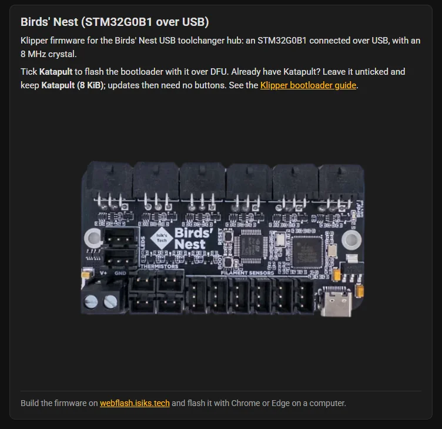
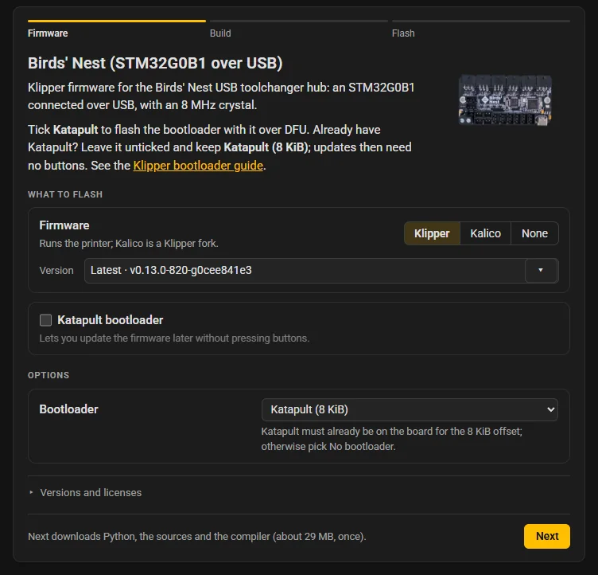
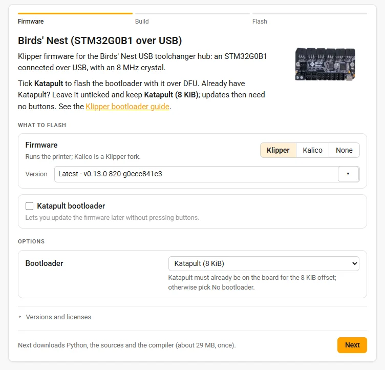
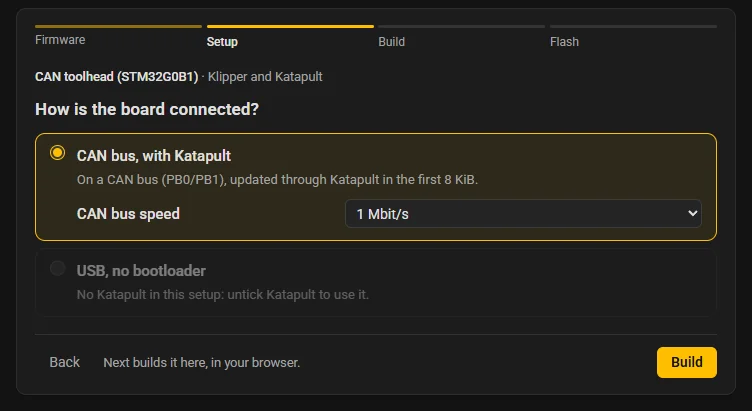
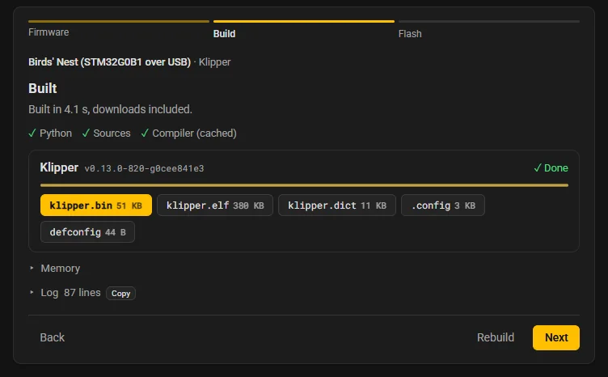
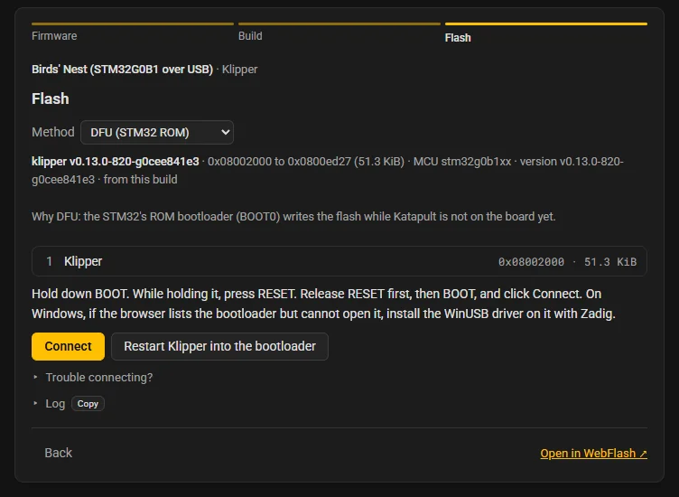
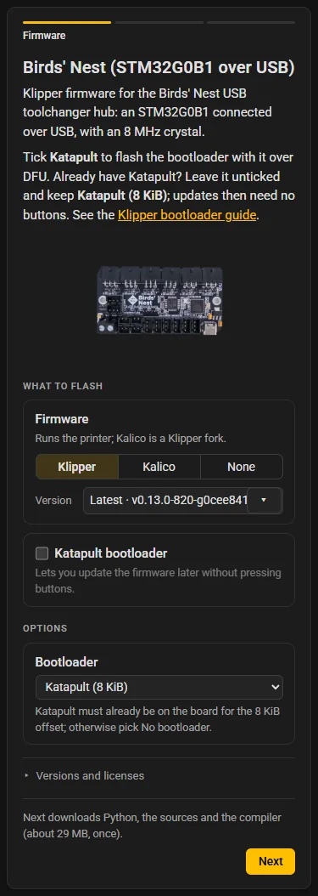

# The generated page

This page describes what `webflash board.toml` and the site's Generate produce: one HTML file, `<name>.webflash.html`, holding a card for one board. It covers what is in the file, what the card does for its readers, how it behaves inside a documentation site, and the URL parameters and messages that control it from outside. [Embedding a card](../embedding.md) is the how-to.

## What is in the file

The file is small, about 10 to 20 KB plus the photo or the firmware file when `-i` puts them inside it. The card's code is not in it: the page loads the WebFlash runtime from the [board TOML's](board-toml.md) `engine_url`, `https://webflash.isiks.tech/engine/v1/` by default, and the runtime downloads the rest only when the reader asks for it. Until the runtime has loaded, and without JavaScript, the page shows a static fallback card.

In order, the file holds:

- **The head**: the board's title as the page's `<title>`, an inline icon, the theme's Google Fonts links when its fonts come from there, and one `<style>` with the theme's CSS and the fallback card's.
- **The theme's CSS variables**: every color token of the [theme](themes.md) as a variable (`--bg`, `--text`, `--accent`, `--panel-bg`, `--log-bg` and the rest), plus `--ui-font`, `--mono-font`, `--font-scale` and `--max-width`. The light palette is on `:root`, the dark one under `prefers-color-scheme: dark` and `:root[data-theme="dark"]`, and the light one again under `:root[data-theme="light"]`, so `data-theme` on `<html>` decides.
- **The theme-sync script**: PinConnect's, word for word, which sets `data-theme` on `<html>` (see [Light and dark](#light-and-dark)).
- **The card root**, `
`, with one `data-*` attribute for every [behavior](#behaviors) of the theme: `data-show-log`, `data-show-image`, `data-compact`, `data-show-versions`, `data-confirm-flash`, `data-font-scale` and `data-max-width`. Switches read `"true"` or `"false"`.
- **The fallback** inside the card root (see [The fallback](#the-fallback)).
- **The configuration**, `<script type="application/json" id="webflash-config">` (see [The configuration](#the-configuration)).
- **The height script**, which reports the page's height to the page it is embedded in (see [Messages](#messages)).
- **The runtime**, `<script type="module" src="<engine_url>embed.js">`.
- A closing comment naming the WebFlash version and its license.

### The fallback

The fallback is plain HTML: the board's title, its description, its photo, and one sentence saying where to get the firmware. For a board built from source:

> Build the firmware (CAN bus, with Katapult) on webflash.isiks.tech and flash it with Chrome or Edge on a computer.

The link opens the board on the WebFlash site ("Open in WebFlash", below), and the setup in brackets is the first setup's title, left out when it has none. For a `[prebuilt]` board:

> Flash it with Chrome or Edge on a computer, or download the firmware: katapult.bin.

with the file as a download link. The fallback is what search engines read, and what a reader without JavaScript, or a page whose runtime cannot be loaded, keeps. When the runtime loads, it replaces the fallback with the card and keeps the fallback's photo element, which with `-i` is the photo's only copy in the file.

### The configuration

`#webflash-config` holds the board TOML's tables as JSON, normalized, with every default applied:

| Key | Holds |
|---|---|
| `schema` | `1`, the version of this layout. |
| `board` | `title`, `description`, `image`, `theme`, `theme_dir`, `engine_url`. |
| `firmware` | `project`, `projects`, `version`, `versions`; `null` for a `[prebuilt]` board. |
| `katapult` | `version`, `versions`, `default`; `null` without `[katapult]`. |
| `setups` | A list of `{id, title, description, defconfig, katapult, methods}`. A `[config]` table is one setup with the id `default` and no title. Empty for `[prebuilt]`. |
| `setups_form` | `"config"` or `"setup"`: which way the TOML wrote them; `null` for `[prebuilt]`. |
| `options` | A list of `{symbol, label, values, labels, help, setups}`, one per `[[option]]`. |
| `flash` | `methods` (`null` for the configuration's own) and `instructions`. |
| `prebuilt` | `file`, `address`, `mcu`; `null` for a board built from source. |
| `toml` | The board TOML's text, comments and all, which "Open in WebFlash" carries. |
| `inline` | Only with `-i` on a `[prebuilt]` board: `{prebuilt}`, the file as a data URL. |

An image inlined with `-i` is only in the fallback's ``, so the photo is not in the file twice. A page whose `schema` is newer than the runtime reads keeps its fallback, with a note under it: "This page needs a newer WebFlash runtime (schema 2; this one reads 1): generate it again, or load the runtime its version names."

## The card

The card is the site's wizard, sized for a frame in a docs page: a step bar, then one step at a time, each with its own footer. Its steps are **Firmware**, **Setup** (only when the TOML has two or more setups), **Build** and **Flash**; a `[prebuilt]` board has **Firmware** and **Flash**. The step bar links back to the steps before the current one; on a card 480 pixels wide or less, it shows only the current step's name. Steps 2 to 4 start with a line naming the board and what is being flashed, such as "CAN toolhead (STM32G0B1) · Klipper and Katapult". The steps move without touching the browser's history, since the card lives in someone else's page.

### Firmware

The first step shows the board: its title, description and photo, the photo beside the text, or under it on a phone. Under them come the [notices](#notices) for what this browser or this frame cannot do, then **What to flash**:

- **Firmware**, "Runs the printer." ("Runs the printer; Kalico is a Klipper fork." when Kalico is offered), with a switch between the firmwares `[firmware] projects` offers, plus **None** when the TOML has `[katapult]`. With one choice, or with the theme's `show_versions` off, the firmware is named instead. A board that is Katapult alone names it as the **Bootloader**.
- **Version**, the version picker: the versions `[firmware] versions` offers, starting with `[firmware] version`. A Mainsail or Fluidd version pasted into it picks that commit, or the closest older one offered ("Closest offered: …"). With one version offered, or `show_versions` off, it is a line naming the version, with an "unchecked" badge when its snapshot did not pass the build checks. [Firmware and versions](../site/firmware.md#versions) describes the picker.
- **Katapult bootloader**, with `[katapult]`: a checkbox, "Lets you update the firmware later without pressing buttons.", ticked at the start when `[katapult] default` is true, and Katapult's version picker while it is ticked. **None** with Katapult ticked flashes Katapult alone; with neither, Next is disabled ("Pick a firmware or Katapult.").
- **Options**, for a TOML with one setup: the options the reader may change (see [Options on the card](#options-on-the-card)).
- **Versions and licenses**, folded: the versions of WebFlash, Python and the compiler, the sources loaded, the number of compiler workers, the storage used, the licenses, and **Clear cache**, as the site's About box shows them.

Nothing heavy loads before the reader asks. Only the list of versions loads with the card (and the list of older commits, about 40 KB compressed, when the TOML names an older commit or the reader opens a picker). **Next** is the consent: the hint beside it says what it downloads and how much, such as "Next downloads Python, the sources and the compiler (about 30 MB, once).", or "Everything is in this browser already." on a later visit. Next starts the Python runtime and the sources of each project picked, starts the compiler's download in the background, and moves on, to Setup or straight to Build. A **Change** button on an option starts the same downloads without moving.

### Setup

"How is the board connected?" offers one radio card per setup, in the TOML's order: its title, its description, and under the one selected, its options. While Katapult is ticked, a setup without a Katapult configuration is disabled, and its card says "No Katapult in this setup: untick Katapult to use it."; ticking Katapult moves to the first setup that has one. The footer's Next is labeled **Build**: "Next builds it here, in your browser."

The reader's choices are kept per setup, so switching setups and back keeps them.

### Options on the card

Each `[[option]]` that applies to the setup is a row with its label, a control and its help:

- Before the configuration has loaded, a choice or an option with `values` is a dropdown of the values offered, set to the defconfig's value, or to **Default** where only the Kconfig knows it. An option without `values` is shown read-only, "as the board's configuration sets it", with a **Change** button.
- Once it has loaded, a choice or an option with `values` stays a dropdown, a yes-or-no option is a checkbox, and a number or a text is a field, which says the range when the symbol has one and refuses a value the symbol does not take, with the reason under it.
- An option that cannot be changed now is disabled with a note: "Not available with the settings above.", "Set by another setting.", "None of its choices is available with the settings above." or "Not in this version."
- The help is the option's `help`; without one, the Kconfig help in an **About this option** fold once the configuration has loaded.

A choice made before the configuration loads is set once it has loaded, in the TOML's order and in passes, so a value that only appears after another choice (a CAN bus speed under the interface that needs it) still lands.

While Katapult is ticked beside a firmware, an option that is Klipper's bootloader offset is disabled, with "Set by Katapult.": the engine sets it from Katapult's application offset. With **None**, the offset is not offered at all, since Katapult's configuration gives those symbols another meaning.

### Build

The Build step builds by itself when the reader arrives from a step before it, once the configuration has loaded, unless the builds it already has still match; coming back from Flash starts nothing. It is the site's [Build](../site/build.md) step: a line of what the build needs (Python, the sources, the compiler), one row per build, Katapult first, with its status and a bar, the files as buttons that download them, and **Memory** and **Log** folded. "Built in" counts the whole wait, downloads included; its tooltip gives the compile time. **Cancel** stops a build and **Rebuild** builds again; **Next** is enabled once the build is done.

A configuration that did not load shows "The configuration did not load", the reason, and **Try again**.

### Flash

The Flash step is the site's flash panel in its compact form: the method select, the list of what is written, the steps before **Connect**, the progress, the result with the `printer.cfg` lines, and the log. Its methods are what the build's `.config` allows, narrowed and ordered by the setup's `methods`, else by `[flash] methods`, and its instructions are `[flash.instructions]`'s. Katapult and the firmware built together are flashed as one, as on the site; [Flashing methods](../flashing.md) and the site's [Flash](../site/flash.md) step describe each method.

It offers the builds only while they match the reader's picks; otherwise it says "Build first." or "The settings changed since the build: build again." The notices of the first step are repeated above it. For a board built from source, its footer has **Open in WebFlash**.

### A prebuilt board

A `[prebuilt]` board has two steps. Firmware shows the board and a line naming the file, the address range it writes and its chip, and Flash flashes it with the methods its chip allows (the TOML's `mcu`, else the file's own), narrowed by `[flash] methods`. The file comes from inside the page (`-i`) or from beside it; a file that cannot be downloaded says so ("katapult.bin could not be downloaded from beside this page (HTTP 404)."). Nothing of the build loads for such a card: no Python, no sources, no compiler.

### On a phone

At 480 pixels or less, the step bar shows only the current step's name, the photo goes under the text, controls take the full width and the hint sits on its own line above the footer's buttons. The page never scrolls sideways.

## Open in WebFlash

**Open in WebFlash**, in the Flash step's footer, opens the board on the WebFlash site in a new tab, with every option of `make menuconfig`. It is the site of the TOML's `engine_url` with `#toml=` and a board TOML after it, base64url-encoded:

- While the reader has changed nothing, it carries the page's own TOML text, comments and all, as the fallback's link does.
- Once they have, it carries a TOML written from their picks: the setup they picked first, so the site opens on it, with their choices in its configuration; the firmware and versions they picked (a pinned version the TOML's `versions` list lacks joins the list); and Katapult as they left it. Unticked, only that setup loses its Katapult configuration. With **None**, it is a Katapult-alone TOML of the setups that have Katapult.

## Behaviors

The card's behaviors come from the theme's [`[behavior]` table](themes.md), never from the board TOML, through the card root's `data-*` attributes (see [`[behavior]`](themes.md#behavior)):

| Behavior | What the card does |
|---|---|
| `show_log` | Opens the build log and the flash log at the start. |
| `show_image` | `false` hides the photo, in the fallback and the card. |
| `compact` | Hides the description, in the fallback and the card, and the build's Memory table. |
| `show_versions` | `false` names the firmware and its version instead of offering the firmware switch and the version pickers. |
| `confirm_flash` | Asks the reader to confirm the device, the address range and the method before writing. On by default. |
| `font_scale` | Scales the card's text (`--font-scale`). |
| `max_width` | The card's widest, in pixels (`--max-width`). |

## Notices

The first step, and the Flash step again, say what this browser or this frame cannot do:

- In a browser without WebUSB and Web Serial: "Firefox cannot flash from a web page: build here, download the files, then flash them with Chrome or Edge, or your usual tools." ("Safari" or "This browser" for others).
- In a frame from another origin that allows neither USB nor serial ports: "The page this card is embedded in does not let it use USB or serial ports, so it cannot flash from here: download the files, or open this card in a tab of its own (the site can allow it with `allow="usb; serial"` on the embed)."
- Serial ports withheld only: "The page this card is embedded in does not let it use serial ports, so Katapult over a USB or UART serial port is not offered (DFU, PICOBOOT and Katapult through a CAN adapter still work): for it, open this card in a tab of its own (the site can allow it with `allow="usb; serial"` on the embed)."
- USB withheld only: "The page this card is embedded in does not let it use USB, so DFU, PICOBOOT and CAN adapters are not offered (Katapult over a serial port still works): for those, open this card in a tab of its own (the site can allow it with `allow="usb; serial"` on the embed)."

"open this card in a tab of its own" links to the page itself. The card still builds and offers the files for download. Even with `allow="usb; serial"`, a frame from another origin cannot open a folder picker, so the UF2 drive is offered as a `.uf2` download there. [Embedding a card](../embedding.md#from-another-origin) has the embed tag.

If the runtime cannot be loaded, the fallback stays. When `embed.js` loads but the rest of the runtime does not, a line under the fallback says so: "The WebFlash runtime could not load from", the address and the reason.

## Light and dark

The page follows the reader's color scheme, or the scheme of the documentation page it is embedded in, live, and both palettes come from its [theme](themes.md). The theme-sync script sets `data-theme` on `<html>` from, in order: `?theme=`, a same-origin parent's `data-md-color-scheme` (MkDocs Material and Zensical), `data-theme` or `dark` class, which it keeps watching; else `prefers-color-scheme` applies. A `{pinconnectTheme}` message overrides all of these. [Light and dark mode](../../guides/light-dark.md) explains the order, and the [light and dark example](../examples/light-dark.md) shows it.

## URL parameters

Add them to the page's address, in a link or in an embed tag:

| Parameter | Values | Effect |
|---|---|---|
| `theme` | `dark`, `light` | Pin the color scheme, so the page no longer follows its surroundings. |
| `mock` | `dfu`, `katapult`, `uart`, `can`, `picoboot`, `uf2` | Run the Flash step against scripted devices instead of real ones, with `&fail=` for the error paths, as on the site. For testing a card without a board; see [The site's URL parameters](site.md). |

## Messages

A page that embeds a card can talk to it with `postMessage`:

- **`{ pinconnectTheme: "dark" }`** or `"light"` sets the color scheme, and any other value clears it. The key is PinConnect's on purpose, so one script on a host page drives every tool; see [Light and dark mode](../../guides/light-dark.md#across-origins).

The page sends one message, **`{ mdIframeHeight: h }`**: `document.body.scrollHeight`, rounded up, whenever the card's size changes, as it moves between steps and as the build's results and the log open and close. It sends it only when embedded and never sends 0, and an embedded page hides its own scrollbar, since the frame grows to fit. md-iframe sizes the iframe to it; the [auto-height protocol](../../md-iframe/auto-height.md) describes it for other embedding code.

Inside the page, the runtime fires a `webflash-relayout` event on `window` for a change of size the height script's `ResizeObserver` cannot see, such as a photo that has finished loading; the height script reports again on it. The runtime starts firing it once the card has replaced the fallback, so the frame does not shrink and grow back while the fallback gives up its photo.

## The same bytes everywhere

The site's Generate and the command line render through the same code, so the same board TOML and files give the same bytes, with or without `-i`. Nothing in the page depends on when, where or on what it was rendered: no timestamps, random values, absolute paths or environment, a fixed table of media types for data URLs, the configuration JSON with sorted keys and ASCII only, and LF newlines on every platform. A page committed to a repository changes only when its TOML, its files, its theme or the WebFlash version changes.

## What `/engine/v1/` serves

The runtime a page loads is a folder of ES modules on a WebFlash site. The `v1` in its address is the version of the runtime that pages are rendered against.

| Path under `/engine/v1/` | What it is |
|---|---|
| `embed.js`, `embed-ui.js`, `embed-build.js`, `embed-model.js` | The card: the entry point, the steps, the firmware flow (loaded only for a board built from source) and its logic. |
| `runtime.js`, `state.js`, `toml-io.js`, `dialogs.js` | The site's own modules the card uses: the Python worker's calls, the session, the TOML reader and writer, the About content. |
| `build/`, `configure/`, `flash/`, `wizard/`, `workers/` | The site's build, configure, flash and wizard modules and its workers, the same files the site runs. |
| `css/` | The card's stylesheet, `css/embed.css`. |

From the same site, a card built from source downloads the Python payload (`webflash.zip`), the source snapshots (`sources/`) and the compiler (`toolchain/`); the Python runtime itself, Pyodide, comes from jsDelivr. The site allows every origin to load them, so a page served from any host can. The compiler and the source bundles, whose addresses name their content, are kept in the browser's cache under the docs site's origin, so a second visit, or another card on the same site, does not download them again. [Embedding a card](../embedding.md#the-runtime-and-engine_url) covers pointing a page at another runtime.
