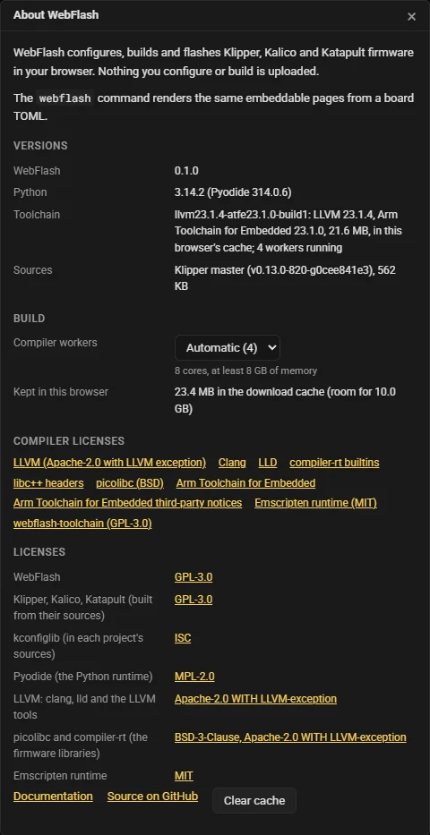

# Site URLs and storage

This page lists what the WebFlash site reads from its address, what it keeps in your browser between visits, and which servers it talks to. The site's steps are described in [Firmware](../site/firmware.md) and the pages after it; a generated card has its own parameters, in [The generated page](page.md).

## URL parameters

| Parameter | Values | Effect |
|---|---|---|
| `#toml=` | the board TOML, base64url | Open that board TOML, as **Open TOML** does. See [below](#open-a-board-toml-from-a-link). |
| `?config=` | a URL | Download a board TOML and open it. See [below](#open-a-board-toml-from-a-url). |
| `?project=` | `klipper`, `kalico`, `katapult` | Preselect the firmware on page 1. `katapult` is Katapult alone (**None** with Katapult ticked). |
| `?version=` | a version | Preselect the firmware's version: `latest`, `release`, a branch or tag such as `master` or `v0.13.0`, or an older commit's `git describe` string such as `v0.13.0-819-ga5b36c393`, as a board TOML's `[firmware] version` takes it. Without `?project=`, it applies to the firmware already picked, Klipper on a first visit. |
| `?theme=` | `dark`, `light` | Pin the site's color scheme. Without it the site is dark unless your system asks for light, and follows the system as it changes. |
| `?mock=` | see [Testing without hardware](#testing-without-hardware) | Run the Flash step against scripted devices. |

They combine: `https://webflash.isiks.tech/?project=kalico&version=release&theme=light` opens page 1 with Kalico's newest checked release, in light. A board TOML named by `#toml=` or `?config=` replaces what `?project=` and `?version=` picked, since it names its own. A preselection is where the page starts, not a change: leaving the page does not warn about unsaved changes for it.

The site never rewrites its address. Moving between the steps adds browser history entries without changing the URL, so the browser's **Back** and **Forward** move between steps, and a link copied from the address bar opens the page as the link was.

### Open a board TOML from a link

`#toml=` followed by the board TOML's text as base64url (RFC 4648 section 5, without padding) of its UTF-8 bytes. This is what a card's **Open in WebFlash** link and the site's **Copy link** (in Generate) carry, so a reader can take a card's board, with the picks they made in it, to the site:

```
https://webflash.isiks.tech/#toml=W2JvYXJkXQp0aXRsZSA9ICJNeSBib2FyZCIK...
```

- The part after `#` never reaches a server, so the board TOML in such a link stays in the browser.
- Standard base64 works too, padded or not, with `+` and `/` percent-encoded or not. A link that mixes the two alphabets, holds any other character, or does not decode to UTF-8 is refused with **Could not open the board TOML in the link**, rather than opening half a TOML.
- The TOML is checked as **Open TOML** checks it, and the site goes on to Configure, or to Flash for a `[prebuilt]` board.

The site also follows a `#toml=` link opened later in the same tab, such as one pasted into the address bar. When the board you are working on has unsaved changes, it asks first, **Open the board TOML in the link?**, with **Open the link** and **Keep my board**; one question at a time, answered for the link the address shows by then. **Back** and **Forward** across the entry of the link the board came from only move between steps; they do not open it again.

### Open a board TOML from a URL

`?config=<url>` downloads a board TOML and opens it. The server holding the file must allow the site to fetch it: it must send `Access-Control-Allow-Origin` (CORS), as GitHub Pages and `raw.githubusercontent.com` do. A relative URL is resolved against the site's address. The file's name is the URL's last segment when it ends in `.toml`, else `board.toml`.

```
https://webflash.isiks.tech/?config=https://raw.githubusercontent.com/<user>/<repo>/main/board.toml
```

When the download fails, **Could not load the board TOML** says whether the server could not be reached or refused the request (CORS), or answered with an HTTP error. A `#toml=` in the same address wins over `?config=`.

`?config=` cannot name files beside the TOML: a board photo given as a path, or a `[prebuilt]` file, is opened with **Open TOML** together with the TOML instead.

## Testing without hardware

`?mock=<kind>` replaces WebUSB, Web Serial and the folder picker with scripted devices, so the Flash step can be run end to end without a board. The site starts on the Flash step with a small generated firmware at the method's usual address; **Upload firmware** replaces it, and a build that finishes replaces it too. The console logs `WebFlash mock mode: <kind>`.

| `?mock=` | The device | Its own parameters |
|---|---|---|
| `dfu` | An STM32 in its ROM bootloader. | |
| `picoboot` | An RP2040 in BOOTSEL mode, over PICOBOOT. | |
| `uf2` | An RP2040's BOOTSEL drive, for the UF2 drive method. | `&chip=rp2350`: an RP2350's drive. |
| `katapult` | A board running Klipper on USB, which the restart turns into Katapult, and that Katapult port. | |
| `uart` | A USB-UART adapter wired to a board running Klipper in UART mode, which the serial bootloader request restarts into Katapult on the same port. | `&baud=<n>`: the board's baud rate (250000 by default). `&boot=katapult`: the board starts in Katapult. |
| `can` | A candleLight adapter on a bus with a node in Katapult (`aabbccddeeff`), a node running Klipper (`010203040506`), and a Klipper node its host holds (`112233445566`), which answers no query, so only its typed `canbus_uuid` reaches it. | `&bus=host`: only the node the host holds. |

`&fail=<what>` makes one thing go wrong, to show its explanation and fixes:

| `&fail=` | What goes wrong | For |
|---|---|---|
| `cancel` | The device picker is closed without a pick. | every kind |
| `verify` | The verification after the write fails. | every kind but `uf2` |
| `claim` | The USB interface cannot be claimed, as when another program holds it. | `dfu`, `picoboot`, `can` |
| `mcu` | The device reports another chip than the firmware's. | `katapult`, `uart`, `can` |
| `rdp` | The STM32's flash is read-protected. | `dfu` |
| `hang` | Opening the device never finishes, as on Windows without the WinUSB driver. | `picoboot` |
| `timeout` | Katapult does not answer at first. | `katapult` |
| `busy` | Katapult answers busy once. | `katapult` |
| `baud` | The uploaded file says 250000 baud, the board was built for 115200. | `uart` |
| `vanish` | The drive goes away with the last block, as when the ROM restarts into the firmware: a successful flash. | `uf2` |
| `unplug` | The drive goes away after 64 KiB, before the board has the whole file: a cable pulled. | `uf2` |

`&os=windows|linux|mac|android` and `&browser=firefox|safari|brave` make the page believe it runs elsewhere, to show the fixes and notices it gives there (Firefox and Safari lose WebUSB and Web Serial, Android loses Web Serial, Brave loses the folder picker).

```
https://webflash.isiks.tech/?mock=can&bus=host
https://webflash.isiks.tech/?mock=picoboot&fail=hang&os=windows
```

A generated card takes the same `?mock=`, see [The generated page](page.md).

## What the site keeps in your browser

Nothing you configure or build is uploaded. The board you are working on lives in the page; reloading it or closing the tab loses unsaved changes (the browser warns first). Between visits the site keeps a few settings in local storage and its large downloads in Cache Storage, both only in this browser and for this site.

### Local storage

| Key | Holds |
|---|---|
| `webflash.configure.auto` | `1` once a version's sources have loaded in this browser: later visits load the configuration at once, behind page 1, without waiting for **Next**. |
| `webflash.build.auto` | `1` once the compiler is in the download cache: a later **Build** downloads nothing new and asks nothing. **Clear cache** removes it, so the next build lists its downloads and waits for a click. |
| `webflash.build.workers` | **About**'s **Compiler workers**, 1 to 8. Absent means **Automatic**. |
| `webflash.kconfig.folds.<project>` | Which menus of the Configure tree you opened or closed, per project. |
| `webflash.config.minimal` | The **.config** tab's **Minimal (defconfig)** checkbox. |
| `webflash.tab` | The Embed step's last tab: Embed options, .config or TOML. |
| `webflash.build.reuse` | A measurement switch for developers, off unless set to `1` by hand: run every job of a compiler worker on one long-lived instance. |

A browser that blocks storage (a private window, some embedded contexts) still runs the site; it only forgets these between visits.

### The download cache

The compiler and the firmware sources never change under their URLs, so the site keeps them in Cache Storage, in a cache named `webflash-v1`, and a returning visit downloads nothing but two small files:

| What | Kept | Checked |
|---|---|---|
| The compiler release: `toolchain/<id>/` (`manifest.json`, `llvm.js`, `llvm.wasm.gz`, `toolchain.js`, `sysroot.tar.gz`, and the C++ headers once a C++ build needs them) | Forever | Each file against the release manifest's size and SHA-256; a copy that does not match is dropped and downloaded again. |
| The source bundles: `sources/blobs/<sha256>.tar.gz` | Forever | Against the SHA-256 in its name, before it is kept. |
| The list of versions, `sources/index.json`, and of older commits, `sources/history/<project>.json` | Not kept | Asked for again on every visit, with the server's answer revalidated. |
| The current compiler release's name, `toolchain/current.json` | Not kept | Asked for again each time the compiler is needed. |

The Python runtime, Pyodide, comes from jsDelivr and is kept by the browser's ordinary HTTP cache. The site's own Python package, `webflash.zip`, is fetched fresh on every load.

A download that breaks off names the file and how far it got, and nothing of it is kept. The cache belongs to the site it was filled from: a card embedded in a documentation site keeps its downloads under that site, apart from the WebFlash site's.

### Clear cache

**About** (the **?** in the top bar) shows the versions of WebFlash, Python, the compiler and the loaded sources, the **Compiler workers** setting, and how much the site keeps in this browser (**Kept in this browser**).



**Clear cache** deletes the `webflash-v1` cache: the compiler and every source bundle download again when next needed, and the next **Build** lists what it will download and waits for a click. It leaves the local storage settings and the browser's own HTTP cache alone; your browser's site settings clear those.

## Where the downloads come from

The compiler and the source snapshots come from the **assets origin**. The site reads it from a `<meta name="webflash-assets" content="<url>">` tag in its `index.html`:

- **The hosted site** has no such tag, so it fetches `toolchain/` and `sources/` from its own origin, `https://webflash.isiks.tech/`.
- **A local `webflash`** writes the tag into the page it serves. With `--assets URL` (by default `https://webflash.isiks.tech/`) the tag names that site, which the browser can fetch from because GitHub Pages sends `Access-Control-Allow-Origin: *`. With `--assets DIR` the tag is empty and the local server serves the folder's `toolchain/` and `sources/` itself. See [Run the site locally](../command-line.md#run-the-site-locally).

A generated card finds them the same way through its runtime: from the site its `engine_url` belongs to, unless a local server wrote another URL into the runtime.

## What the site sends where

| To | What | When |
|---|---|---|
| The site itself | The page, its scripts and `webflash.zip` | On load |
| The assets origin (the site itself, unless a local `webflash` names another) | `sources/` and `toolchain/` downloads | When you configure a version and when you build |
| `cdn.jsdelivr.net` | The Pyodide runtime, a pinned version | When Python boots: page 1's **Next**, opening a TOML, Generate |
| `fonts.googleapis.com`, `fonts.gstatic.com` | The site's fonts (Roboto, Roboto Mono) | On load |
| The URL in `?config=` | One request for the board TOML | When the address names one |

These are all requests for files: none carries your board, your configuration or your firmware, and the `#toml=` part of an address is never sent. Flashing talks only to the device you pick in the browser's own device picker, over USB or serial on your computer. The links in **About** (the documentation, the source on GitHub, the licenses) open only when you click them.
