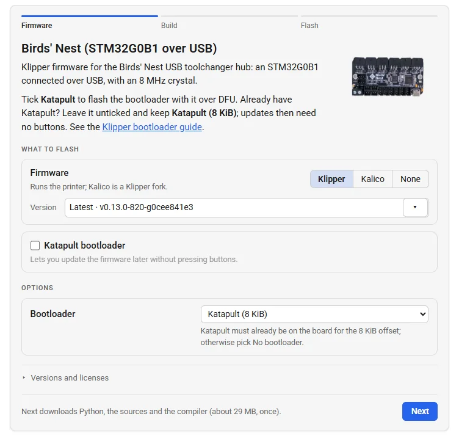
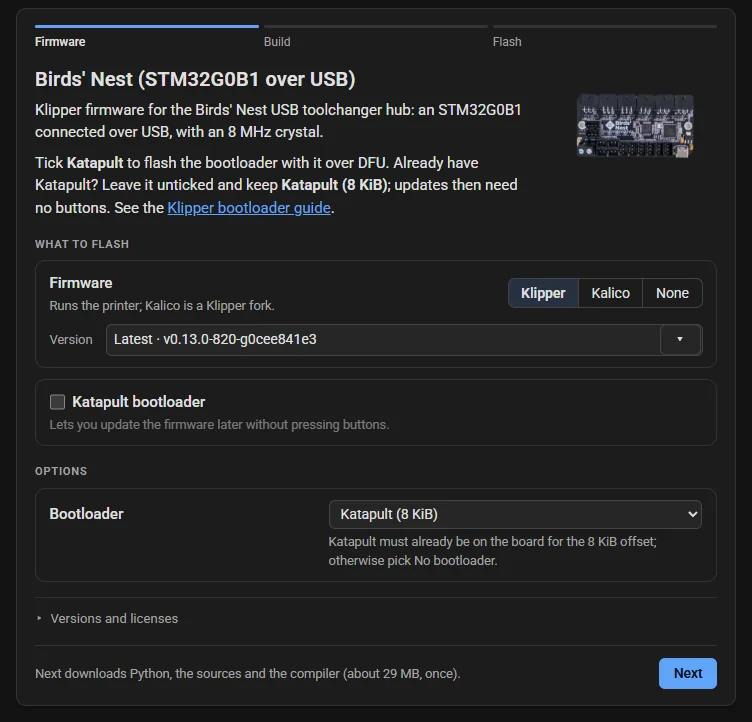
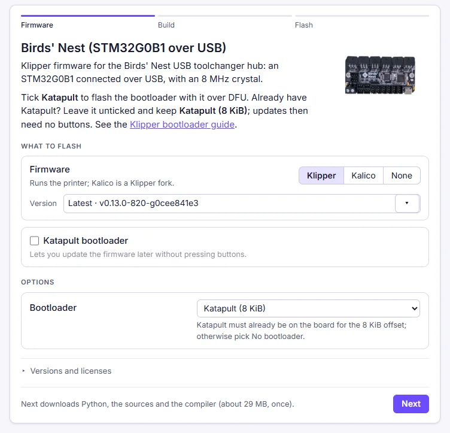
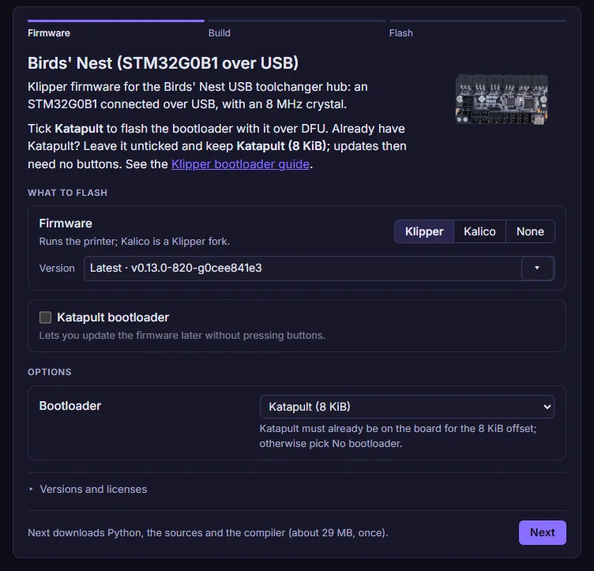
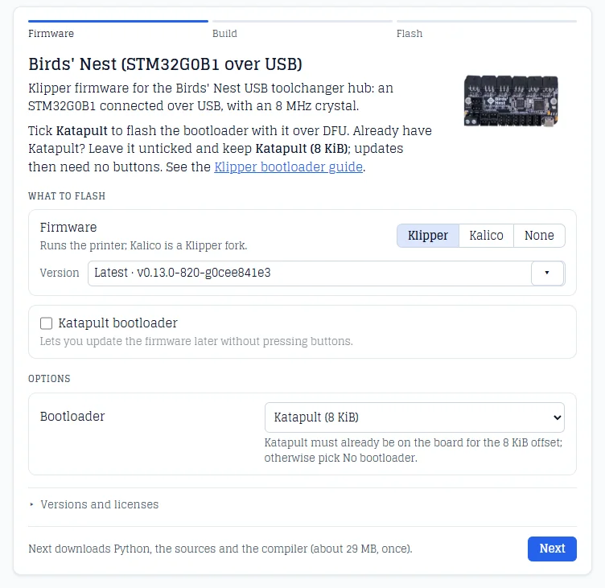
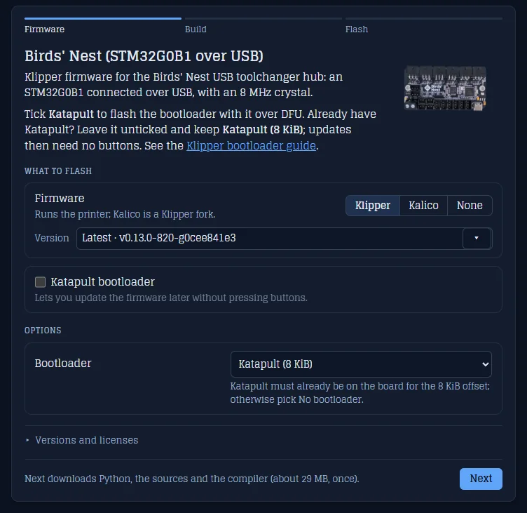
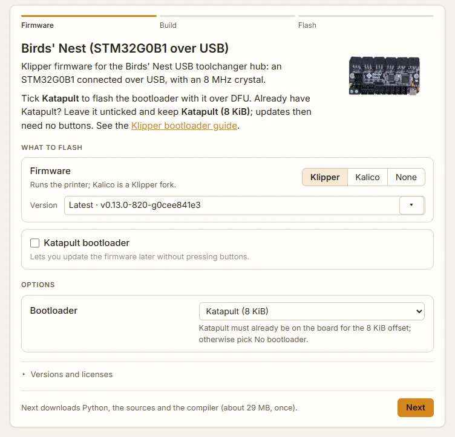
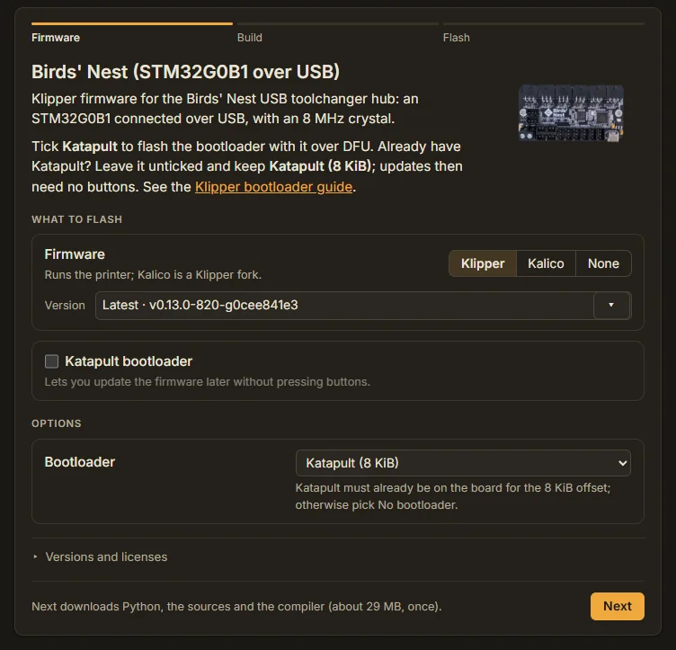

# Themes

A theme controls how a generated card looks and behaves: the colors of the card, its buttons, its log and its status lines, the fonts, and a few behaviors such as whether the log starts open or the version pickers show. What the card builds and flashes is board data and stays the same across themes.

Themes are bundled with `webflash`, and you can add your own. A theme file has the same shape as a [PinConnect theme](../../pinconnect/reference/themes.md) and a [3DStep theme](../../3dstep/reference/themes.md), with WebFlash's own tokens and behaviors, so a site keeps one theme file for each tool.

Themes apply to the generated page only. The WebFlash site has its own dark and light look.

## Applying a theme

Set the board's theme in the `[board]` table of its [board TOML](board-toml.md):

```toml
[board]
title = "STM32G0B1 over USB"
theme = "midnight"
```

Or override it on the command line (this wins over the board's `theme`):

```bash
webflash board.toml --theme slate
```

Precedence is **`--theme` → `[board] theme` → `default`**. A theme name is resolved from the board's `theme_dir` (default `./themes`, next to the TOML) first, then from the themes bundled with the package. An unknown name is an error naming both places it looked: `Theme 'ocean' not found in <your themes folder> or <the bundled themes folder>`.

In the site, the **Theme** selects of the Embed options tab and the Generate dialog set `[board] theme`, so the saved TOML renders to the same page with the command line. The site offers the bundled themes only; see [your own theme](#creating-your-own-theme).

## Bundled themes

| Theme | Look |
|-------|------|
| `default` | The stock light and dark palette, with a blue accent, Roboto and Roboto Mono. What you get with no theme. |
| `midnight` | Indigo-tinted, with a violet accent, Inter and JetBrains Mono. The build and flash logs start open. |
| `slate` | Cool blue-gray, deep navy in dark mode, blue accents, Glegoo, a serif face. |
| `workbench` | Warm neutrals with an amber accent and dark text on the amber buttons, Inter. |

Each takes its palette from the PinConnect theme of the same name, so a pinout and a card look alike on one site. Every theme provides both a light and a dark palette. See [Light and dark mode](#light-and-dark-mode) for how the page chooses between them.

## Light and dark mode

The generated page has no light/dark control of its own: it takes the scheme from its surroundings. In order, it follows a `?theme=dark` or `?theme=light` parameter, then the embedding page's scheme (same origin only, tracked live), then the reader's OS preference. A parent page on another origin sets it by posting `{ pinconnectTheme: "dark" }` to the iframe: the key is PinConnect's on purpose, so one host script drives every tool.

[Light and dark mode](../../guides/light-dark.md) explains each step and the message in full, and the [light and dark example](../examples/light-dark.md) shows it live.

## Theme gallery

The same board in each bundled theme, light and dark, on the card's first step.

### `default`

| Light | Dark |
|:-----:|:----:|
|  |  |

### `midnight`

| Light | Dark |
|:-----:|:----:|
|  |  |

### `slate`

| Light | Dark |
|:-----:|:----:|
|  |  |

### `workbench`

| Light | Dark |
|:-----:|:----:|
|  |  |

## Anatomy of a theme file

A theme is a TOML file whose name is the theme name (`midnight.toml` defines `midnight`). Every field is optional and **merges over the built-in defaults**, so a theme only states what differs. A minimal theme is just a name:

```toml
[theme]
name = "My Theme"
```

`name` is the display name, what the site's Theme selects show. It defaults to the file's own name. Board TOMLs and `--theme` always refer to a theme by its **filename**, not this.

A theme file has five tables: `[theme]`, `[font]` (with `[font.mono]`), `[behavior]`, `[colors]` (with `[colors.light]` and `[colors.dark]`) and `[extra_css]`. Any other table, and an unknown key in one of these, is ignored with a warning, such as `[layout] is not a theme table; ignoring it.`

### `[colors.light]` / `[colors.dark]`

CSS color values (hex, `rgb()`, `rgba()`, `color-mix()`, `transparent`, …). Token names are the generated CSS variables without the leading `--`. `light` applies in light mode, `dark` in dark mode.

| Token | Light | Dark | What it colors |
|-------|-------|------|----------------|
| `bg` | `#ffffff` | `#131313` | The page behind the card |
| `text` | `#1a1a1a` | `#e0e0e0` | Primary text |
| `text-muted` | `#666666` | `#a3a3a3` | Secondary text: hints, the step bar, sizes, notes, the fallback's notice |
| `panel-bg` | `#f6f6f6` | `#1c1c1c` | The card |
| `panel-border` | `#dddddd` | `#333333` | The card's border, and the borders of its rows: the firmware and Katapult rows, the setups, the build rows |
| `panel-shadow` | `rgba(0,0,0,.08)` | `rgba(0,0,0,.4)` | The card's shadow |
| `accent` | `#2563eb` | `#60a5fa` | Primary buttons (Next, Build, Connect, Flash), progress bars, checkboxes and radio buttons, the focus outline, links, the finished steps in the step bar, the memory bars |
| `accent-text` | `#ffffff` | `#0b1220` | Text on the primary buttons |
| `control-bg` | `#ffffff` | `#262626` | Buttons, selects, text fields, the version list, inline `code` |
| `control-border` | `#cccccc` | `#444444` | Their borders, and the firmware switch's |
| `control-text` | `#1a1a1a` | `#e0e0e0` | Text in buttons, selects, text fields and the version list |
| `log-bg` | `#111111` | `#0b0b0b` | The build and flash logs, the printer.cfg snippet, error details |
| `log-text` | `#e0e0e0` | `#d4d4d4` | Their text |
| `ok` | `#15803d` | `#4ade80` | Done: a finished build row, a flash that succeeded, checked prerequisites |
| `warn` | `#b45309` | `#fbbf24` | Warnings and notices, "unchecked" badges, files from an earlier configuration |
| `error` | `#b91c1c` | `#f87171` | Errors, a failed build or flash, a refused value, a memory region that is full |
| `divider` | `#e5e5e5` | `#333333` | The line above each step's buttons, the step bar's track, separators |
| `scroll-thumb` | `rgba(0,0,0,.22)` | `rgba(255,255,255,.20)` | The logs' scrollbar thumb |
| `scroll-track` | `transparent` | `transparent` | The logs' scrollbar track |

```toml
[colors.light]
accent      = "#d6851a"
accent-text = "#1a1814"

[colors.dark]
accent      = "#f0a83c"
accent-text = "#1a1814"
```

Setting `bg = "transparent"` in both palettes lets an embedded card sit on the background of whatever it is in, the page itself or an admonition, instead of painting its own; see [a theme for a docs site](#a-theme-for-a-docs-site). The generated page declares a `color-scheme` to match the palette it is showing, which is what browsers require before they will let an iframe stay transparent over a host page in the opposite mode.

Names outside this table are not rejected: they are emitted as CSS variables too. Defining `my-accent` in both palettes gives you `var(--my-accent)` to use from [`[extra_css]`](#extra_css), with light/dark switching handled for you. A name must be letters, digits, `-` and `_`; any other is ignored with a warning.

Values are checked as they load. A bare hex with no `#` (`bg = "f8f8f8"`) is not valid CSS, so `webflash` adds the `#` for you and prints a warning. A value that is no recognizable color at all (a misspelled `gray`, say) is left alone but still warned about, since it would leave that element unstyled. An empty value keeps the default, also with a warning, and a value holding `{`, `}`, `<` or `>` is ignored with one. All of these are warnings, not errors: the page is still written. The site's Generate dialog shows the same warnings.

Only the tokens in the table are checked for being a color at all. A name outside it may hold any CSS your `[extra_css]` wants, so there only the hex checks apply: a missing `#` is added, and a hex with the wrong number of digits is warned about.

### `[font]` and `[font.mono]`

The UI font, and the monospace font for the logs, the printer.cfg snippet, sizes, versions shown as text and inline `code`.

| Key | Meaning |
|-----|---------|
| `family` | Font family name |
| `source` | `google` (loaded from Google Fonts), `bundled` (a font file embedded in the output as base64, keeping it self-contained), or `system` (`family` is used verbatim as a CSS stack) |
| `weights` | Weights to request, e.g. `"400;500;600"`: `google` only |
| `file` | Path to the font file relative to the theme, e.g. `"inter.woff2"`: `bundled` only (`.woff2`, `.woff`, `.ttf` or `.otf`) |

Without `[font]` the card uses Roboto (`400;500;600`) from Google Fonts. `[font.mono]` takes the same keys and, unlike PinConnect's `[font.label]`, does not follow `[font]`: without it the monospace font is Roboto Mono (`400;500`). A key a table leaves out keeps that default, so `family = "Inter"` alone is Inter from Google Fonts with Roboto's weights.

```toml
[font]
family = "Inter"
source = "google"
weights = "400;500;600"

[font.mono]
family = "JetBrains Mono"
source = "google"
weights = "400;500"
```

A system stack keeps the page free of any font download:

```toml
[font]
family = "system-ui, -apple-system, 'Segoe UI', sans-serif"
source = "system"
```

A `source` outside the three, a key that is not a string, a `google` or `bundled` family with a quote or a backslash, a `system` stack with `;`, `{`, `}`, `<` or `>`, and a `bundled` font without a `file` or whose file does not exist are errors, such as `mytheme.toml: [font]: font source must be google|bundled|system, got 'adobe'`.

### `[behavior]`

How the card behaves. These apply to the generated page only; the site's Embed options tab shows the behaviors of the theme you picked.

| Key | Default | Effect |
|-----|---------|--------|
| `show_log` | `false` | Start with the build log and the flash log open. Without it, each is folded under **Log** until the reader opens it. |
| `show_image` | `true` | Show the board's photo, when the board TOML names one. `false` hides it on the card and in the static fallback. |
| `compact` | `false` | Hide the board's description and the Build step's **Memory** table. |
| `show_versions` | `true` | Show the version pickers and the firmware switch (Klipper, Kalico, None). `false` shows the project and its version as text, so the reader builds what the board TOML names. The **Katapult** checkbox stays. |
| `confirm_flash` | `true` | After **Connect**, show the device that was picked, what will be written, and a **Flash** button, and write nothing until the reader clicks it. `false` starts writing as soon as the device is connected. |
| `font_scale` | `1.0` | Scale the card's text, and with it everything sized to the text. From `0.5` to `3`. |
| `max_width` | `720` | The card's widest, in px. At least `280`. The card is narrower in a narrower frame. |

```toml
[behavior]
show_log  = true
compact   = true
max_width = 640
```

A boolean must be `true` or `false`, and a number a number (a string holding one, `"1.1"`, is taken too); anything else is an error, such as `mytheme.toml: [behavior]: show_log must be true or false (got 'yes')`. `font_scale` and `max_width` outside their range are pulled in rather than rejected, and `max_width` is rounded to whole pixels. An unknown key is a warning and is ignored, so a theme written for PinConnect or 3DStep still loads: `[behavior] sidebar_default_open is not a WebFlash behavior; ignoring it.`

> **Embedding.** The card grows and shrinks as the reader moves through its steps and as the build's results and the logs open and close. Embedded with [md-iframe](../../md-iframe/embedding.md), the iframe follows it, with no scrollbar inside the frame. Every WebFlash page reports its height with the [auto-height protocol](../../md-iframe/auto-height.md).

### `[extra_css]`

A raw-CSS escape hatch, for anything the tokens can't express. It is emitted verbatim, so it is a trusted, author-controlled surface: keep board data out of it.

It comes after the generated variable blocks but before the page's own rules for the card box, and before the runtime's stylesheet, which the card loads from `engine_url`. A rule that changes something either of them styles needs a more specific selector: `#wf-card`, the card's root, outranks both.

```toml
[extra_css]
css = """
#wf-card { border-radius: 14px; }
#wf-card .wf-title { letter-spacing: -.01em; }
"""
```

The page's elements have classes starting with `wf-`. `[extra_css]` may also be a plain string instead of a table with `css`.

### The page's variables and attributes

Every theme value reaches the page as a CSS variable on `:root`, for `[extra_css]` and your own styles:

| Variable | From |
|----------|------|
| `--bg`, `--text`, `--accent`, `--log-bg`, … | Each `[colors.*]` token, the built-in ones and your own, switched with the scheme |
| `--ui-font` | `[font]`, as a `font-family` value with a `system-ui, sans-serif` fallback |
| `--mono-font` | `[font.mono]`, with a `ui-monospace, Consolas, monospace` fallback |
| `--font-scale` | `[behavior] font_scale` |
| `--max-width` | `[behavior] max_width`, in px |

Each behavior is also a `data-*` attribute on the card's root, `<div class="wf-card" id="wf-card">`: `show_log` is `data-show-log`, and booleans read `"true"` or `"false"`. A rule such as `#wf-card[data-compact="true"] .wf-title { font-size: 1.1em; }` styles one behavior. [The generated page](page.md) lists the rest of what is in the file.

## A theme for a docs site

The live examples on this site use `isikstech`, a theme kept in `docs/firmware/` beside the board folders rather than bundled with WebFlash. Each board TOML names it with `theme = "isikstech"` and `theme_dir = ".."`. Its page is transparent, so the card sits on the site's own background in both schemes, with the site's amber for the buttons and the progress bars, and Roboto like the site:

??? example "`isikstech.toml`"

    ```toml
    --8<-- "docs/firmware/isikstech.toml"
    ```

[Publish on a docs site](../../guides/publishing.md#a-shared-theme) shows the folder layout.

## Creating your own theme

1. Copy [`default.toml`](https://github.com/xbst/webflash/blob/master/src/webflash/themes/default.toml) (it documents every token and behavior) to `<name>.toml`, and uncomment and override what you want to change.
2. Put it either in the **bundled themes** folder (`src/webflash/themes/` in a clone of the repository, shipped with the package) or in a **board-local** `theme_dir` next to your board TOML (handy for a site theme you don't want to bundle). A board-local theme of the same name overrides a bundled one.
3. Reference it with `theme = "<name>"` (or `--theme <name>`).

A theme in the bundled folder appears in the site's Theme selects when you run the site from that clone (`webflash`) and reload it: the site reads the same files the renderer does.

A board-local theme reaches only the command line. The site cannot read your `theme_dir`, so its Generate lists the theme as `<name> (not bundled)` and refuses to render it, saying to use the `webflash` command line or a bundled theme. When a bundled theme has the same name, Generate renders with that one instead and warns that the command line would produce a different file. Render such boards in CI, as this site does: see [embedding a card](../embedding.md) and the [command line](../command-line.md).

## Tips

- Because tokens merge over the defaults, start from a few overrides (`accent`, `accent-text`, `panel-bg`) and add more only as needed.
- Keep `accent-text` readable on `accent` in both palettes: it is the text of every primary button. A light accent such as amber reads better with dark text.
- Keep `log-bg` dark in both palettes, or set `log-text` to match: the logs are long and read best as light text on a dark box.
- Check a theme in both schemes with `?theme=light` and `?theme=dark` on the generated page, and on a phone: at 480 px and narrower the card stacks its rows and the step bar names only the current step.
